[English](README.md) | Türkçe

# Mobil-Package

Birbirinden bağımsız beş mobil ürünün monoreposu. Her ürün kendi klasöründe, kendi teknoloji
yığını, araçları ve yayın döngüsüyle yaşar; ürünler arasında paylaşılan kod yoktur.

## Projeler

| Klasör                    | Ürün                                                                                                                                                      | Teknoloji                                                                      | Durum                                                              | İlerleme |
| ------------------------- | --------------------------------------------------------------------------------------------------------------------------------------------------------- | ------------------------------------------------------------------------------ | ------------------------------------------------------------------ | -------- |
| [`kadro`](kadro/)         | Halı saha maç organizasyonu: kadro kur, eksik oyuncuyu bul, saha ücretini böl                                                                             | Expo (React Native), Next.js, PostgreSQL + PostGIS, pg-boss                    | Planlanan tüm fazlar birleşti (gerçek dünya kanıtları kısmen açık) | %100     |
| [`askida`](askida/)       | "Askıda ekmek" geleneğine dayalı dayanışma ağı: bağışçılar doğrulanmış yerel esnaftan ürünleri önceden öder, ihtiyaç sahipleri tek kullanımlık kodla alır | Flutter, Laravel, PostgreSQL + PostGIS, Redis, iyzico                          | Planlanan tüm fazlar birleşti (gerçek dünya kanıtları kısmen açık) | %100     |
| [`cetele`](cetele/)       | Küçük esnaf için çevrimdışı çalışan dijital veresiye defteri                                                                                              | Kotlin (Jetpack Compose), Spring Boot, PostgreSQL                              | 7 fazın tamamı birleşti (sunucu, Android uygulaması, faturalama, herkese açık web, sertleştirme; gerçek dünya doğrulamaları açık) | %100     |
| [`inecekvar`](inecekvar/) | Türkiye şehirleri için kitle kaynaklı dolmuş / minibüs hat haritası; A noktasından B noktasına planlama ve çevrimdışı şehir paketleri                     | Ionic (Angular + Capacitor), Angular SSR, FastAPI, PostgreSQL + PostGIS, Redis | Faz 0-4 birleşti (API, Ionic uygulama ve PWA, SSR web ve yönetim); Faz 5 (webhook) PR #127'de; Faz 6 (sertleştirme) çekme isteği için bir dalda | %71      |
| [`patika`](patika/)       | Sokak hayvanları için topluluk platformu: besleme noktası haritası, "beslendi" bildirimleri, sahiplendirme ilanları, veteriner rehberi                    | .NET MAUI (C#), ASP.NET Core, PostgreSQL + PostGIS                             | Yalnızca tasarım dokümanı, kod yok                                 | %0       |

## Galeri

Her proje için bir kart. Kadro'nun, Askıda'nın ve Cetele'nin uygulaması var. Üç uygulama kartının da düzeni aynı: gerçek web ana sayfasının (yerel derleme, örnek veri) bir Android ekranıyla kompoziti ve altında üç Android uygulama ekranı (emülatör, örnek veri). Tam setler [`kadro/docs/screenshots/README.md`](kadro/docs/screenshots/README.md), [`askida/README.tr.md`](askida/README.tr.md#ekran-görüntüleri) ve [`cetele/docs/release/screenshots`](cetele/docs/release/screenshots/README.md) içinde. "web demo" bağlantıları, her projenin gerçek herkese açık sayfalarının yerel derlemelerden alınmış statik görüntülerini (örnek veri) GitHub Pages'te açar ([dizin](https://ayberkaarda.github.io/Mobiles-5in-One/)); giriş, form ve ödeme orada çalışmaz. Inecek Var kartı bir yer tutucudur (API birleşti, uygulama arayüzü henüz yok); Patika kartı henüz tasarım aşamasındaki bir ürün için yer tutucudur.

<table>
  <tr>
    <td width="50%" align="center">
      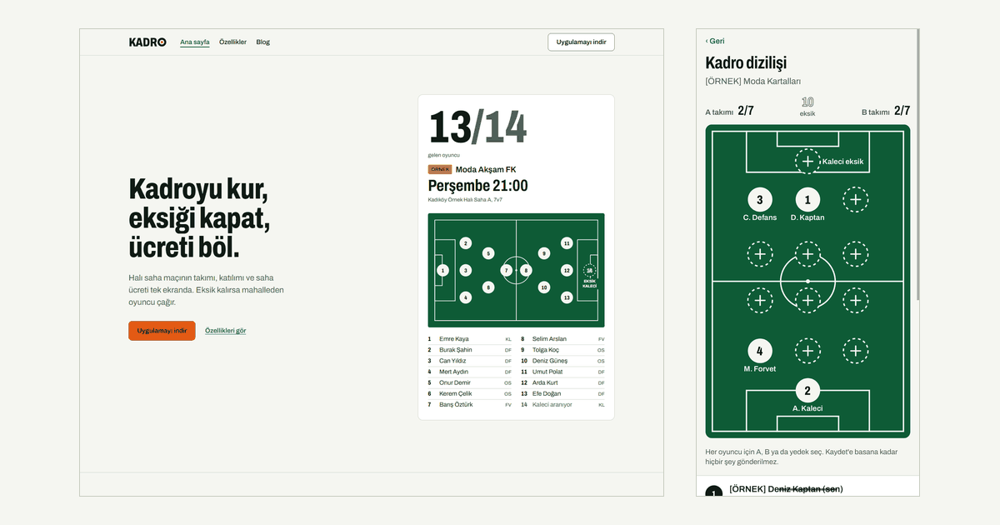<br>
      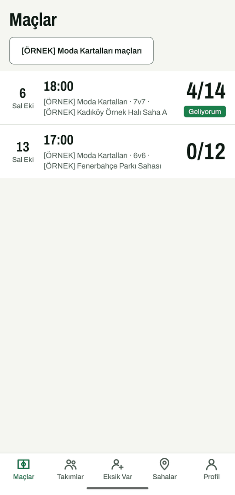
      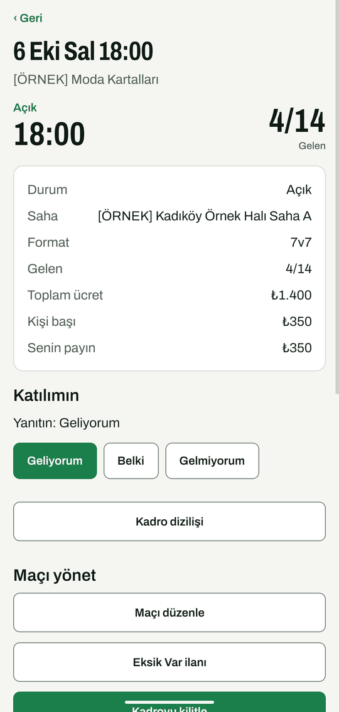
      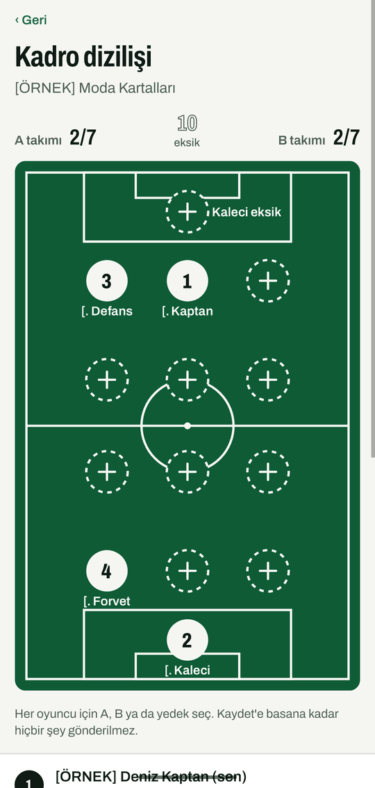<br>
      <sub><b>Kadro</b>: web sayfaları ve Android uygulama ekranları (emülatör, örnek veri); planlanan tüm fazlar birleşti · <a href="https://ayberkaarda.github.io/Mobiles-5in-One/kadro/">web demo</a></sub>
    </td>
    <td width="50%" align="center">
      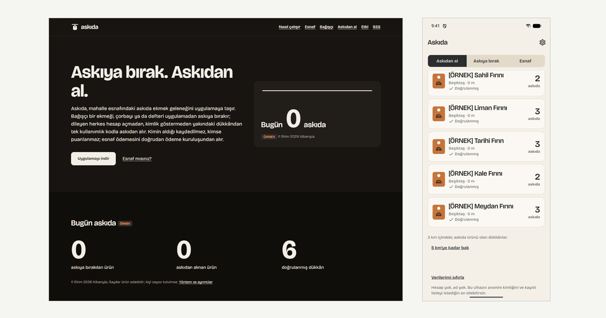<br>
      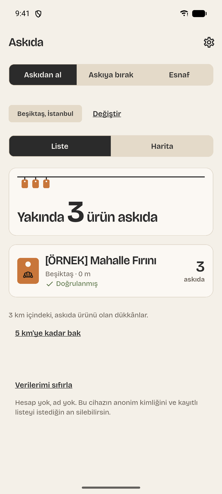
      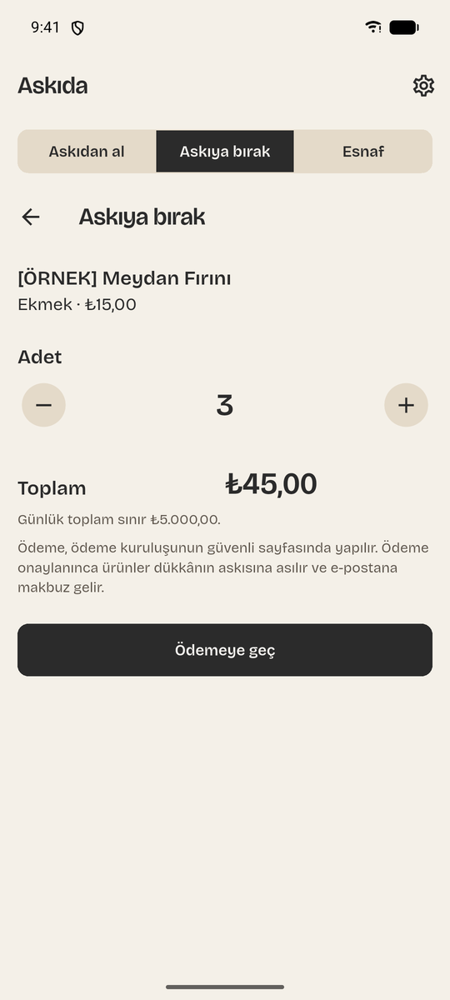
      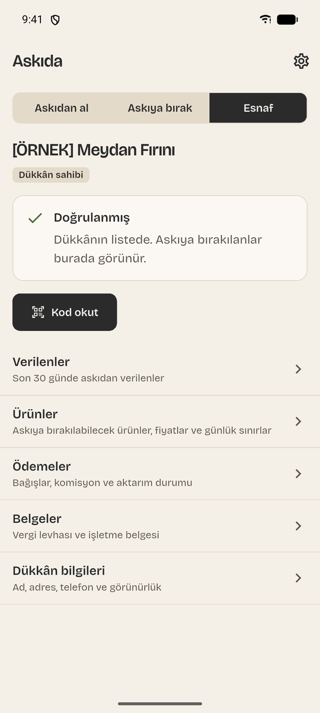<br>
      <sub><b>Askıda</b>: web ana sayfası ve Android alıcı ekranı (yerel yığın, örnek veri) · <a href="https://ayberkaarda.github.io/Mobiles-5in-One/askida/">web demo</a></sub>
    </td>
  </tr>
  <tr>
    <td width="50%" align="center">
      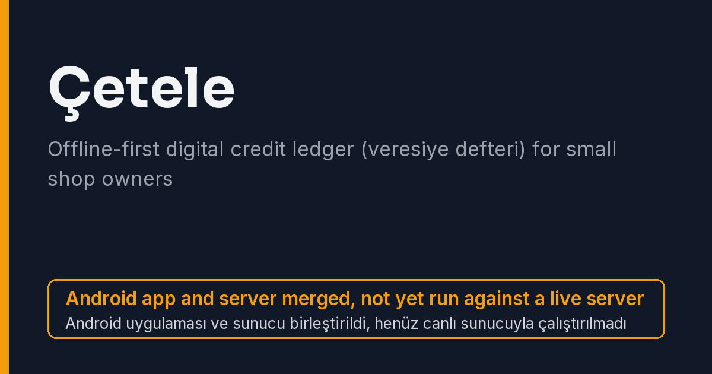<br>
      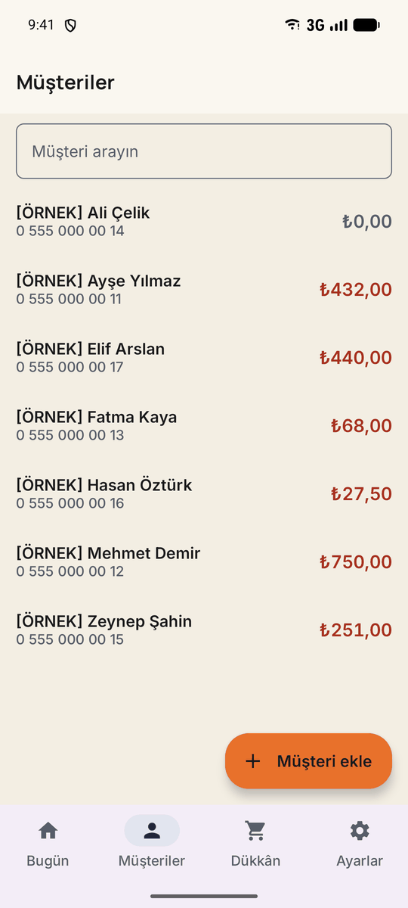
      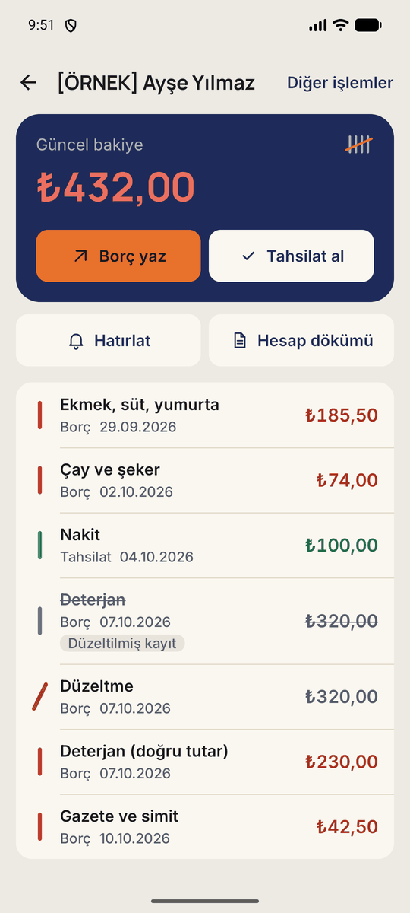
      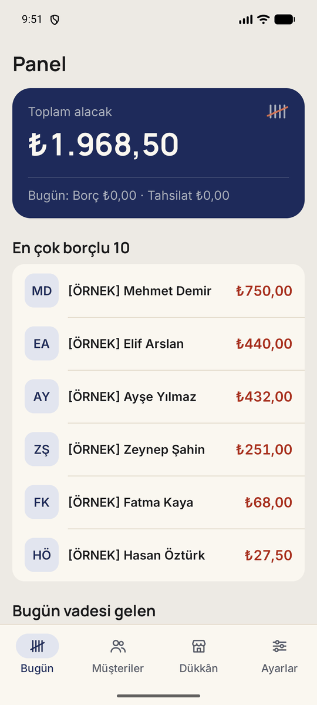<br>
      <sub><b>Cetele</b>: web ana sayfası ve Android müşteri listesi (yerel sunucu, örnek veri) · <a href="https://ayberkaarda.github.io/Mobiles-5in-One/cetele/">web demo</a></sub>
    </td>
    <td width="50%" align="center">
      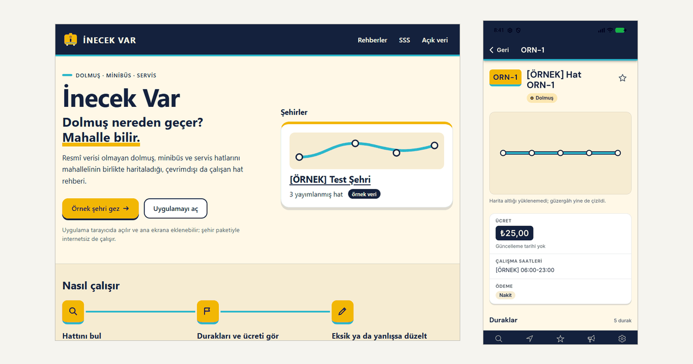<br>
      <sub><b>Inecek Var</b>: API birleşti (faz 0-2), uygulama arayüzü henüz yok</sub>
    </td>
  </tr>
  <tr>
    <td width="50%" align="center">
      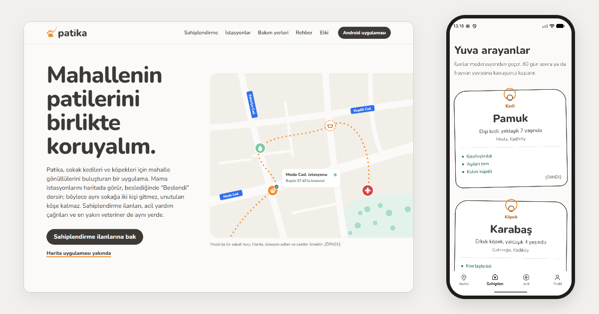<br>
      <sub><b>Patika</b>: tasarım aşamasında, henüz uygulama yok</sub>
    </td>
    <td width="50%"></td>
  </tr>
</table>

## Durum

Kadro'nun planlanan fazlarının hepsi birleşti. Depo iskeleti, Phase 1 (veri modeli, kimlik
doğrulama ve güvenlik çekirdeği) ve Phase 2 (domain API ve worker işleri) tamamlandı; Phase 3 ile 5
(mobil uygulama, SEO sayfaları, abonelik ve yönetim paneli) için tüm iş paketleri birleşti; Phase 6
(sağlamlaştırma ve yayına hazırlık) çıktılarının hepsi birleşti: saldırı paketi, ZAP ve MobSF
taramaları, bağımlılık denetim raporu, geri yükleme tatbikatı, maliyet dokümanı ve maliyet bekçisi,
geçmiş temizleme runbook'u, ASO, mağaza metinleri, gizlilik etiketleri, 23 maddelik nihai doğrulama
matrisi ve SEO ile GEO kontrol listesi. Açık kanıtlar açık olarak kayıtlıdır:
matrisin 23 maddesinden 10'u kısmi, Lighthouse laboratuvar LCP değeri üç sayfada 2,5 ile
2,7 sn, yeni CI adımları da henüz GitHub Actions'ta çalışmadı. Eksik kanıt henüz var olmayan
sistemlere bağlı (EAS derlemeleri, barındırılan bir origin, Sentry hesabı, sağlayıcı hesapları,
yedek depolama, iOS). Birleşti, gerçek dünyada doğrulandı demek değildir: satın alma gerçek mağaza
hesaplarıyla denenmedi, yasal ve mağaza metinleri örnektir. Yeniden tasarım (ADR-0084: açık ve koyu
şema, Archivo yazı tipi, web ve uygulamada kadro kâğıdı görünümü) birleşti; mobil Maestro akışları
emülatörde 11/11 geçiyor, ancak fiziksel cihazda koşu yok. Ayrıntı için
[`kadro/README.tr.md`](kadro/README.tr.md) dosyasına bakın.

Askıda'nın planlanan yedi fazının tamamı hazır: Docker'da çalışan Laravel sunucusu (kimlik
doğrulama, dükkânlar ve katalog, askı, iyzico ödeme akışıyla bağışlar, webhook'lar, esnaf
ödemeleri, Filament yönetim paneli, OpenAPI sözleşmesi), bağışçı, esnaf ve anonim alıcılar için
Flutter uygulaması, SEO ve GEO ile herkese açık web ve sertleştirme fazı (saldırı test takımı,
kalıcı XSS taraması, ZAP ve MobSF taramaları, bağımlılık denetimleri, geri yükleme tatbikatlı
şifreli yedekler, gönderim bütçesi, yayın ve mağaza dokümanları). Son güvenlik doğrulama
matrisinde 23 maddenin 14'ü tamam, 9'u kısmi; kısmi olanlar burada bulunmayan sistemlere (ödeme
sağlayıcı hesabı, mağaza hesapları, alan adı ve sunucu, hata izleme, üretim yedek kovası, macOS)
bağlı ya da ancak push'tan sonra çalışır. Gerçek ödeme ve cihaz doğrulaması denenmedi, iOS hiç
derlenmedi. Bkz. [`askida/README.tr.md`](askida/README.tr.md) ve
[`askida/docs/security/verification-matrix.md`](askida/docs/security/verification-matrix.md).

Cetele'nin sunucusu (Spring Boot: kimlik doğrulama, senkronizasyon, defter, hatırlatma, medya, faturalama,
webhook, yönetim konsolu) ve Android uygulaması (Kotlin, Jetpack Compose, yerel işlem kutusuyla
çevrimdışı çalışır, Play Billing) ile birlikte herkese açık web (SEO ve GEO) ve yayın sertleştirmesi
de birleşti: 7 fazın 7'si tamam, gerçek dünya kanıtları açık kalıyor. Ardından sertleştirme grubu
(PR #115), Android uygulaması ve webin tasarım yenilemesi (PR #116) ve güvenlik grubu 2. tur (PR #117:
yeniden kimlik doğrulama kapsamı, cihaz oturumları, dükkân ve SMS üst sınırları, yönetim ve faturalama
düzeltmeleri) birleşti.

Inecek Var'ın 0-2. fazları `main`'e birleşti (PR #118, #119, #120 ve #121): Ionic/Angular mobil PWA ve
Capacitor Android kabuğu ile Angular SSR webi olan bir Nx workspace; veri modeli, kimlik doğrulama,
moderasyon, izler, planlayıcı, şehir paketleri, dışa aktarım ve hesap silme içeren bir FastAPI api.
Uygulama arayüzü (Faz 3, bir dalda sürüyor), web SEO, webhook ve sertleştirme henüz birleşmedi.
Patika hâlâ yalnızca tek bir spesifikasyon dokümanı; uygulama kodu yok.

### İlerleme

Son güncelleme: 2026-10-12 (Cetele sertleştirme, tasarım ve güvenlik gruplarının ve Inecek Var 0-2. fazlarının birleşmesinden sonra yazıldı). Rakamlar tahmindir; bir iş grubu birleştirildikçe güncellenir.

| Proje       | İlerleme | Dayanak                                                                                                                                                                                                                                                                                                                                                                                                                                                                                                                                                                                                                 |
| ----------- | -------- | ----------------------------------------------------------------------------------------------------------------------------------------------------------------------------------------------------------------------------------------------------------------------------------------------------------------------------------------------------------------------------------------------------------------------------------------------------------------------------------------------------------------------------------------------------------------------------------------------------------------------- |
| `kadro`     | %100     | Phase 0 ile 2 tamam; Phase 3 ile 5: 34 iş paketinin 34'ü birleşti; Phase 6: 11 çıktının 11'i birleşti. Yedi faz eşit ağırlıklı: (3 + 3 x 34/34 + 11/11) / 7 = %100. Phase 6 portfolyo kapsamında tamamdır (11 çıktının 11'i birleşti); henüz var olmayan sistemlere bağlı kanıtlar kısmi olarak kayıtlı kalır (23 güvenlik maddesinin 10'u, barındırılan origin, EAS derlemeleri, sağlayıcı hesapları, iOS). Yani %100, planlanan işin birleştiği anlamına gelir; her kontrolün üretimde kanıtlandığı anlamına gelmez.                                                                                                  |
| `askida`    | %100     | Phase 0-6 birleşti: yedi fazın 7'si, eşit ağırlıklı (temel; veri katmanı, kimlik doğrulama ve güvenlik tabanı; dükkânlar, hesaplar ve askı; ödeme akışı, webhook'lar, esnaf ödemeleri ve yönetim paneli; Flutter uygulaması; herkese açık web, SEO ve GEO; sertleştirme ve yayına hazırlık): 7/7 = %100. %100 planlanan işin birleştiği anlamına gelir, her kontrolün üretimde kanıtlandığı anlamına gelmez: 23 güvenlik maddesinin 9'u kısmi kalır ([doğrulama matrisi](askida/docs/security/verification-matrix.md)); gerçek ödeme, gerçek cihaz doğrulaması, mağaza hesapları, barındırılan origin ve iOS denenmedi. |
| `cetele`    | %100     | 7 fazın tamamı birleşti, fazlar eşit ağırlıklı (temel; sunucu çekirdeği, kimlik doğrulama ve güvenlik tabanı; senkronizasyon, defter, hatırlatma ve medya; Android uygulaması; faturalama, webhook ve yönetim; herkese açık web SEO ve GEO; sertleştirme ve yayın hazırlığı): planlanan fazların 7/7'si = %100. Doğrulama matrisinde 12 satır tamam, 11 satır kısmi, 0 satır başlanmadı: kısmi satırlar bu depodan kapatılamayan dış kapılara (Play hesabı, fiziksel cihaz, alan adı, hukuki inceleme) bağlı. JVM ve CI'da doğrulandı; debug uygulama yalnızca README ekran görüntüleri için yerel sunucuya karşı Android emülatöründe çalıştırıldı (giriş, örnek verinin senkronu, üç ekran), fiziksel cihaz ve uçtan uca akış denemesi yok, gerçek Play hesabı yok (Play Developer API, RTDN ve Play Integrity sahte adaptörler ve kayıtlı örneklerle çalıştı), gerçek PDF çıktısı, biyometri ve kamera denenmedi. |
| `inecekvar` | %71      | Plan fazları 0-5 ve Faz 6 sertleştirme, yedi faz eşit ağırlıklı. 0-4. fazlar `main`'e birleşti (PR #118, #119, #120 ve #121, #123, #126: temel; veri modeli, kimlik doğrulama ve güvenlik tabanı; alan modeli, moderasyon, izler, planlayıcı, şehir paketleri, dışa aktarım ve hesap silme; Ionic uygulama ve PWA; Angular SSR SEO/GEO sayfaları ve TOTP adım doğrulamalı moderasyon ve yönetim arayüzü): 5/7 = %71. Faz 5 (RevenueCat ve Resend webhook'ları, hak tanımları, engelleme listesi, gece işleri) açık PR #127'de, Faz 6 (saldırı takımı ve XSS taraması, ZAP ve MobSF, bağımlılık denetimleri, şifreli yedekler ve geri yükleme tatbikatı, maliyet korumaları ve düşük kip, yayın belgeleri, web'den hesap silme, son doğrulama matrisi) çekme isteği için `feat/inecekvar-p6` dalında; ikisi de sayılmadı. Son matris (`inecekvar/docs/security/verification-matrix.md`) 15 satır tamam, 8 kısmi, 0 başlanmamış; yani 23/23 değil: kısmi satırlar barındırma, alan adı ve TLS, R2, sağlayıcı hesapları, güvenlik iş akışlarının GitHub çalıştırmaları, iOS ve sahip kararları gerektiriyor. Denenmeyenler: iOS, canlı barındırma ve TLS, R2 ve PMTiles CDN, gerçek RevenueCat, Resend ve Sentry hesapları, Search Console, Faz 5 ve 6 için GitHub'da CI. |
| `patika`    | %0       | Yalnızca spesifikasyon; kod yok.                                                                                                                                                                                                                                                                                                                                                                                                                                                                                                                                                                                        |

İlerleme `main`'e birleştirilmiş işi ifade eder; yalnızca dalda duran ya da açık bir pull request'teki
iş sayılmaz. %100, tüm fazların birleştiği anlamına gelir; gerçek dünya doğrulaması ayrıca izlenir.

## Depo yapısı

```
.github/workflows/   Kadro için CI (lint, typecheck, build; güvenlik taramaları, mobil uçtan uca,
                     geri yükleme tatbikatı) ve Askıda için CI
.gitleaks.toml       sır taraması yapılandırması
lefthook.yml         git hook yapılandırması
kadro/               Kadro monorepo (pnpm workspaces + Turborepo)
askida/              Askıda: Laravel sunucusu (Docker), Flutter uygulaması, marka paketi, ADR'ler, spec
cetele/              Cetele: Spring Boot sunucusu, Android uygulaması, marka paketi, ADR'ler, spec
inecekvar/           Inecek Var: Nx workspace (Ionic/Angular uygulama, Angular SSR web), FastAPI api, ADR'ler, spec
patika/              tasarım dokümanı
```

## Projelerin dokümantasyonu

- Kadro: [`kadro/README.tr.md`](kadro/README.tr.md) ([English](kadro/README.md))
- Askıda: [`askida/README.tr.md`](askida/README.tr.md) ([English](askida/README.md)); ayrıca
  [`askida/CONTRIBUTING.md`](askida/CONTRIBUTING.md) ve `askida/docs/adr/` altındaki ADR'ler
- Cetele: [`cetele/README.tr.md`](cetele/README.tr.md) ([English](cetele/README.md))
- Inecek Var: [`inecekvar/README.tr.md`](inecekvar/README.tr.md) ([English](inecekvar/README.md))
- Patika: [`patika/README.tr.md`](patika/README.tr.md) ([English](patika/README.md))

## Geliştirme

Kadro, Askıda, Cetele ve Inecek Var derlenebilir; Patika’da kod yok. Cetele için kök dizinde komut yok: Android ve sunucu derlemeleri `cetele/android` ve `cetele/server` içinden çalışır ([`cetele/README.tr.md`](cetele/README.tr.md)). Kadro için komutları `kadro/` içinden çalıştırın:

```sh
cd kadro
pnpm install
pnpm lint
pnpm typecheck
pnpm build
pnpm test
```

Veritabanı kullanan testler çalışan bir Docker daemon gerektirir. Gereksinimler, ortam kurulumu ve
diğer komutlar [`kadro/README.tr.md`](kadro/README.tr.md) dosyasında anlatılıyor.

Askıda sunucusu (Docker gerekir; makinede PHP gerekmez), `askida/` içinden:

```sh
cd askida
docker compose up -d --wait
docker compose exec server php artisan test
```

Askıda uygulaması (Flutter SDK gerekir), `askida/app/` içinden:

```sh
cd askida/app
flutter pub get
flutter analyze
flutter test
dart format --set-exit-if-changed .
```

Depo Conventional Commits kullanır; mesajlar `lefthook.yml` içindeki hook'lar üzerinden commitlint
ile denetlenir. Hook'lar `pnpm --dir kadro exec lefthook install` ile elle kurulur.

## Lisans

Bu proje Apache License 2.0 ile lisanslanmıştır. Bkz. [LICENSE](LICENSE).
