English | [Türkçe](README.tr.md)

# Askıda

[](https://github.com/ayberkaarda/Mobiles-5in-One/actions/workflows/askida-ci.yml)
[](https://github.com/ayberkaarda/Mobiles-5in-One/actions/workflows/askida-security.yml)

"İyilik askıda kalmasın."

Askıda is a pay-it-forward network built on the Turkish "askıda ekmek" (bread on the hook)
tradition. Donors prepay everyday items such as bread, soup, meals or stationery at verified local
shops; recipients collect them anonymously with a one-time code, without creating an account. One
Flutter app serves three modes (donor, merchant, recipient); a Laravel server provides the API, the
public web and the admin panel. The tone is warm, dignified and plain, never pitying. A static
[web demo](https://ayberkaarda.github.io/Mobiles-5in-One/askida/) of the public pages runs on GitHub
Pages; sign-in, forms and payments do not work there.

## Status

Portfolio project. All seven planned phases (0 to 6) are merged to `main`: foundation; data layer,
authentication and the security baseline; shops, accounts and hooks; payments, webhooks, payouts
and the admin panel; the Flutter app; the public web with SEO and GEO; hardening and release
readiness (attack suite, stored-XSS sweep, ZAP and MobSF scans, dependency audits, encrypted
backups with a restore drill, cost guards, release and store documents).

| Area                                                     | State                                                                                                                                                  |
| -------------------------------------------------------- | ------------------------------------------------------------------------------------------------------------------------------------------------------ |
| Server, API, web pages, Filament admin, queues, database | Real code, run locally in Docker and in the test suites                                                                                                |
| Flutter app                                              | Real app, run on the `Pixel_8` Android emulator against the local stack; iOS is not built (needs macOS)                                                |
| Payments (iyzico)                                        | A real iyzico adapter tested against recorded provider responses; local runs use `PAYMENT_PROVIDER=fake` and a fake checkout page; no merchant account |
| Device attestation (Play Integrity, DeviceCheck)         | Platform-channel code exists; no real attestation has been exercised                                                                                   |
| Backups                                                  | Encrypted database archives and the `Askida restore drill` workflow (last run on GitHub Actions passed on 2026-10-19); no production bucket             |
| Hosting, domain, TLS, store listing, error tracking      | Not set up                                                                                                                                             |
| Legal texts                                              | Sample texts, labelled as such                                                                                                                         |

The final verification matrix ([`docs/security/verification-matrix.md`](docs/security/verification-matrix.md))
grades 14 of 23 items done and 9 partial, each with its reason; the partial ones (history purge,
HTTPS, secret hashing, clean logs, webhook signatures, package audit, backups, spend alerts,
attacker-style testing) need systems that do not exist here. The same document records 2985 server
tests and 591 Flutter tests passing.

## MVP features

- Donor and merchant sign-up with email and password, Sign in with Apple and Google, password reset.
- Merchant onboarding: shop details, map pin, verification documents, state `Pending → Verified | Rejected`; only verified shops are visible.
- Merchant catalog: items with category, price and a daily redeem cap.
- Donor flow: browse shops by distance, choose item and quantity, pay through a card checkout, receive a receipt and see donation history, with per-transaction and per-day caps.
- Recipient flow: no account, anonymous device identity, nearby shops with available items, one-time 8-character code (text and QR) valid for 10 minutes, daily fairness caps.
- Redemption: the merchant scans the QR or types the code; the server validates it; the donor receives an anonymous "Askın alındı" push.
- Payout ledger: donations, redeemed counts, settlement status and transparent platform commission.
- Impact: public district-level counters and an in-app donor impact card.
- Push notifications for merchants ("Yeni askı") and donors ("Askın alındı").
- In-app and web account deletion; an anonymous "reset my data" option for recipients.
- Website: marketing and how-it-works pages, verified-shop directory, impact page, guides, legal pages and an admin panel.

Out of scope: cash donations to individuals, recipient accounts or profiles, chat, ratings of
recipients, pharmacy or medical items, multi-currency, delivery, ads, a corporate donor invoicing
portal (planned for v2).

## Screenshots

Captured on the Android emulator (`Pixel_8`) against the local stack; iOS is not built or
captured. Every shop, person and amount on screen is sample data labelled `[ÖRNEK]`, and the
payment ran on the local fake checkout page. Turkish is the default language; one screen shows
English. The merchant payouts screen is not captured because it shows an error on this build.
Captions, capture details and the capture command are in
[`docs/release/screenshots/README.md`](docs/release/screenshots/README.md).

### Recipient (Askıdan al)

| Onboarding | Nearby list | Map | Shop | Code and QR | Settings |
| --- | --- | --- | --- | --- | --- |
| 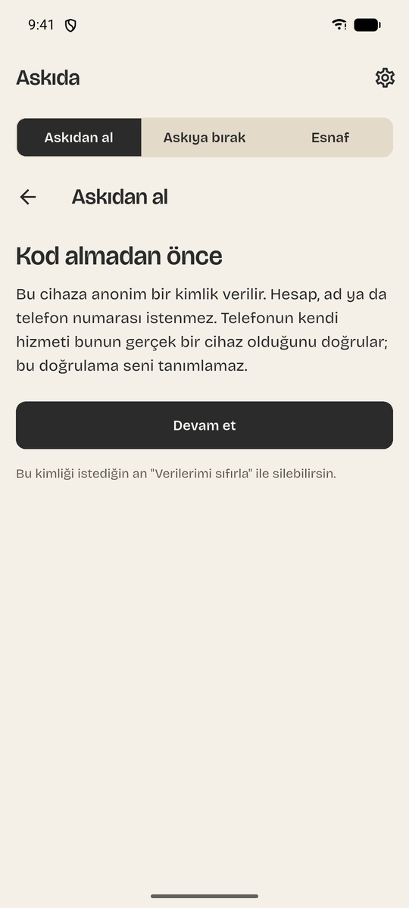 |  | 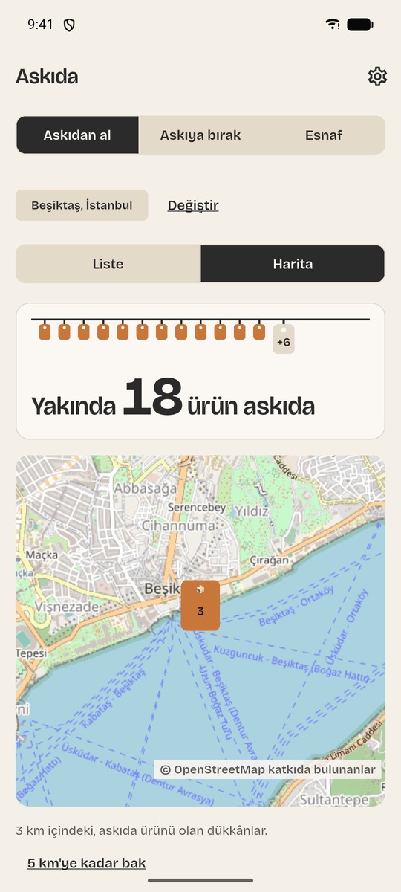 | 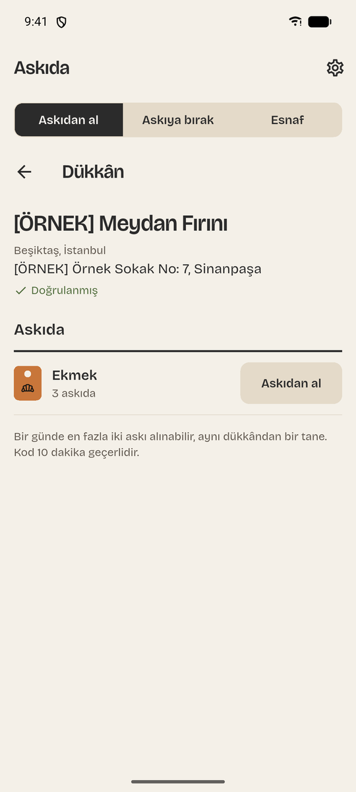 | 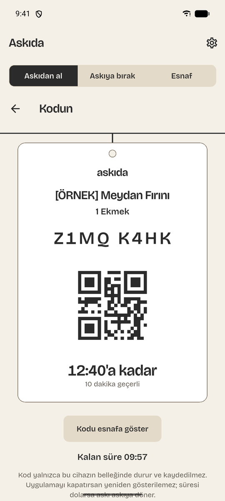 | 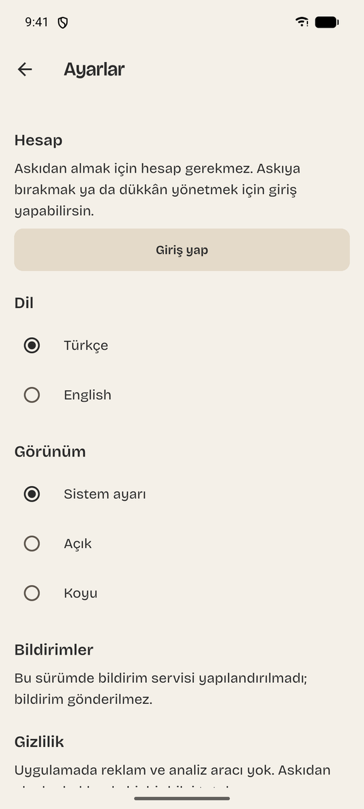 |

### Donor (Askıya bırak)

| Discover | Shop | Donate | Receipt | History | Impact |
| --- | --- | --- | --- | --- | --- |
|  | 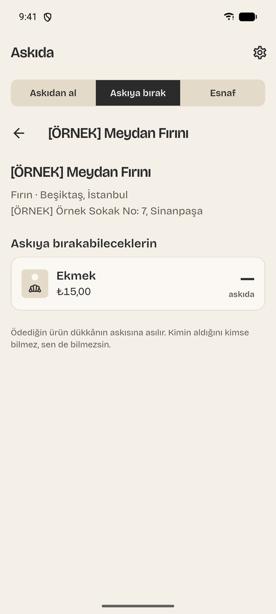 |  | 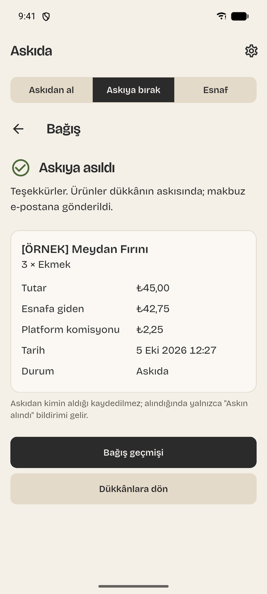 | 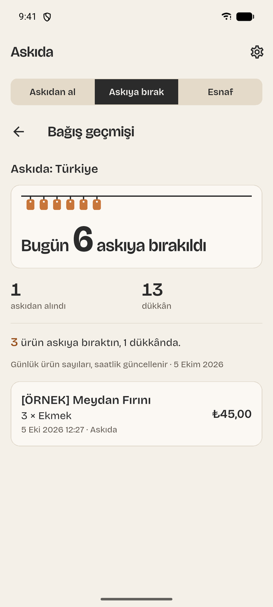 | 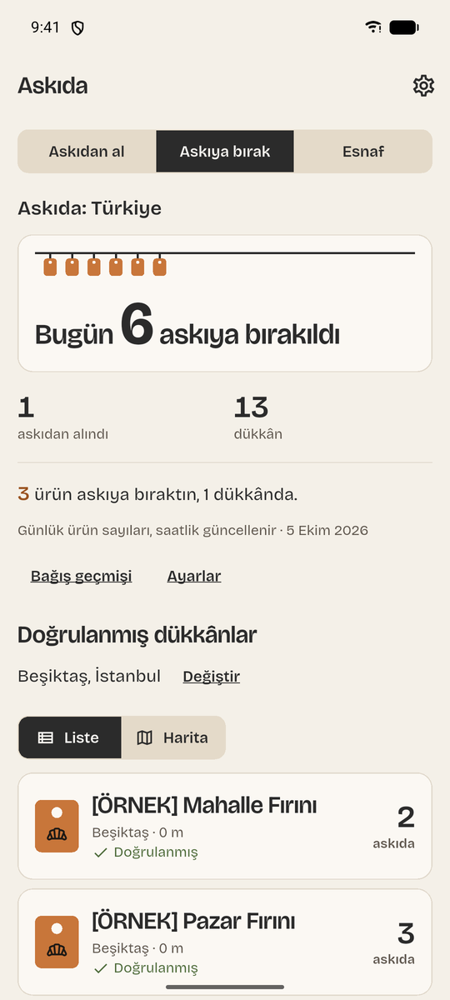 |

### Merchant (Esnaf)

| Shop onboarding | Catalog | Home | Redeem by code | Redeemed | Redemptions |
| --- | --- | --- | --- | --- | --- |
| 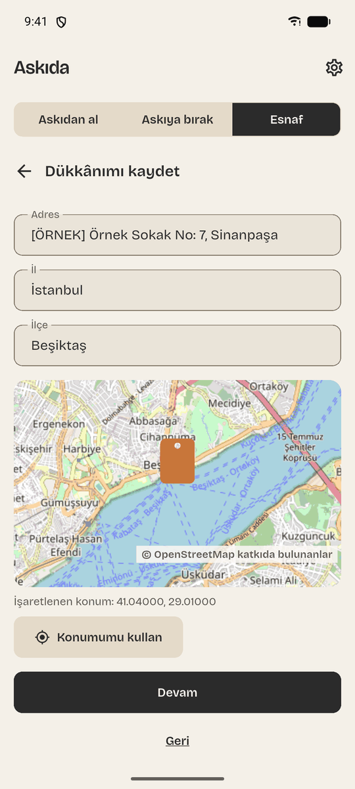 |  |  | 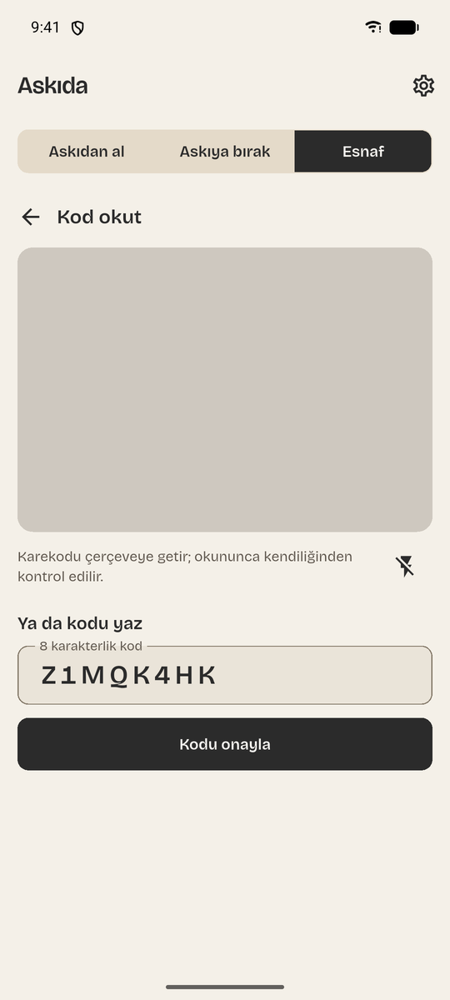 | 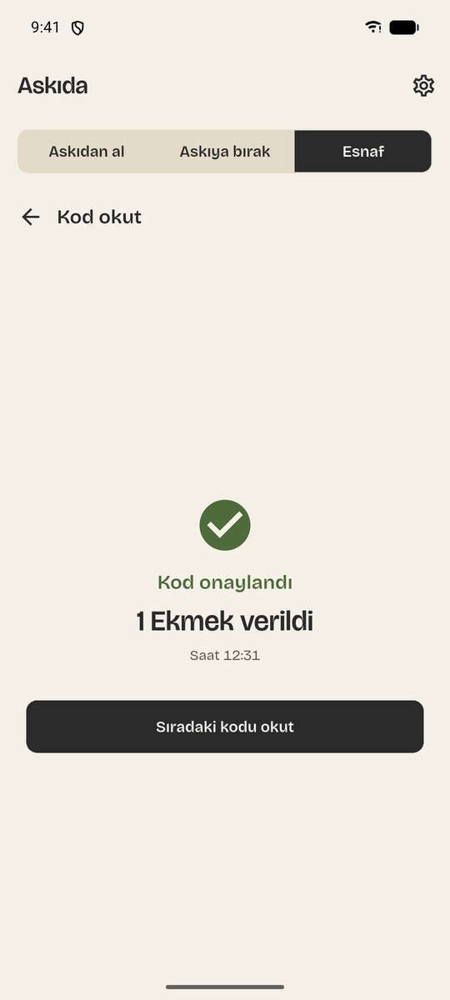 | 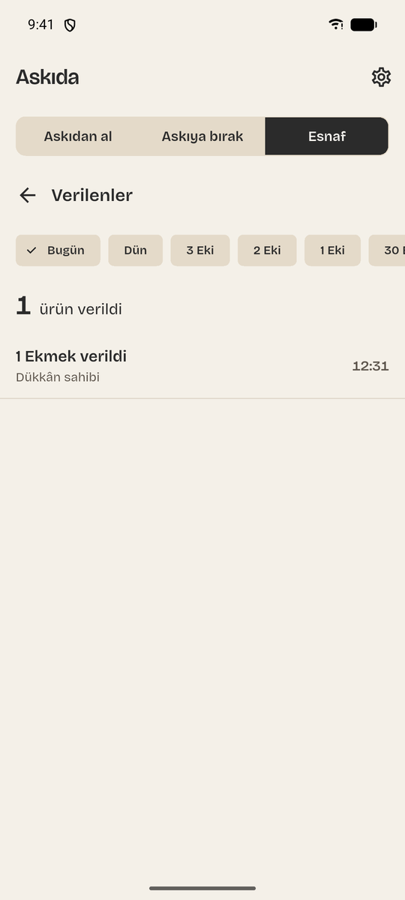 |

### Account, dark scheme and English

| Settings | Delete account | Dark: home | Dark: redemptions | English |
| --- | --- | --- | --- | --- |
| 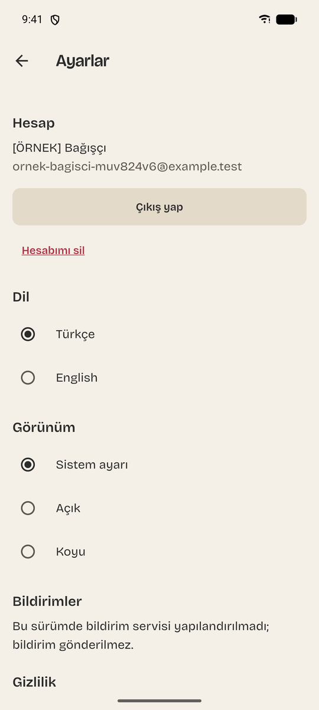 | 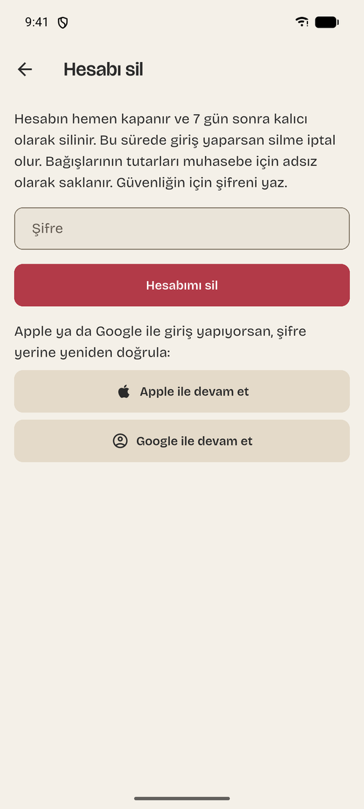 | 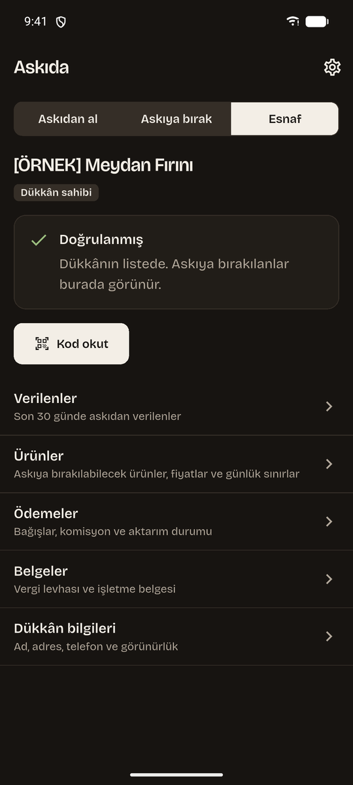 | 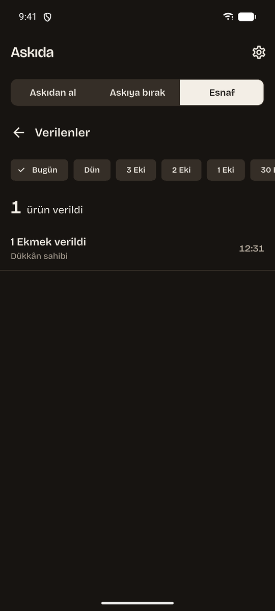 | 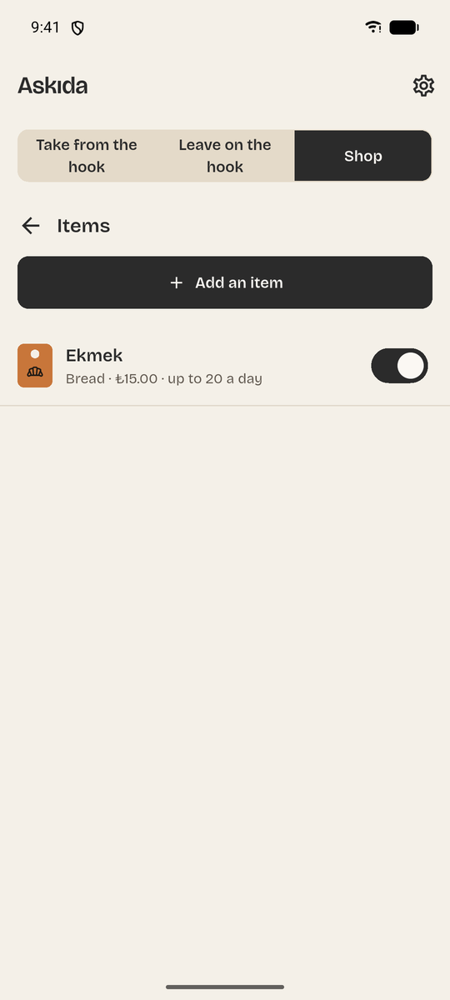 |

## Technology stack

| Layer              | Technology                                                                            |
| ------------------ | ------------------------------------------------------------------------------------- |
| Mobile app         | Flutter 3.47.6 and Dart 3.13.5, Riverpod 3.4.3, go_router 18.0.2, drift 2.35.1        |
| Backend API        | Laravel 13.34.0 on PHP 8.3 (Docker only), Sanctum 4.3.3                               |
| Admin panel        | Filament 3.3.55                                                                       |
| Database           | PostgreSQL 16.9 with PostGIS 3.5.2                                                    |
| Queues and cache   | Redis 7.4.11, Horizon 5.50.0                                                          |
| Object storage     | S3-compatible (MinIO locally, Cloudflare R2 planned)                                  |
| Payments           | iyzico marketplace payments (Checkout Form and sub-merchants), a fake provider locally |
| Web                | Laravel Blade, server-side rendered                                                   |
| Device attestation | Play Integrity (Android) and DeviceCheck (iOS) via platform channels                  |

Resolved versions and the reasoning are in [`docs/adr/0001-stack-and-versions.md`](docs/adr/0001-stack-and-versions.md).

## Architecture

Two main roots: `app/` for the Flutter client and `server/` for the Laravel backend, plus `brand/`
and `docs/`. The backend exposes a versioned JSON API under `/api/v1`, serves the Blade website and
hosts the Filament admin. Money is stored as integer minor units (kuruş) in TRY; the platform never
holds funds, since payments flow from the donor through the payment provider to the merchant.
Recipient anonymity is a core invariant: no accounts, no recipient identity shown to donors or
merchants, and no precise recipient location stored.

## Getting started

Server (needs Docker; PHP runs only inside the containers), from this folder. On first start the
server container installs the Composer packages and creates `server/.env` from `.env.example`:

```sh
docker compose up -d --wait
docker compose exec server php artisan migrate --seed
docker compose exec server php artisan test
```

The web then runs on http://localhost:58080 and Mailpit on http://localhost:58025.

App (needs the Flutter SDK), from `app/`. The drift code is generated, not committed:

```sh
flutter pub get
dart run build_runner build --delete-conflicting-outputs
flutter analyze
flutter test
flutter build apk --debug --flavor dev --dart-define-from-file=env/example.json
```

Contributor rules and the remaining commands (PHPStan, Pint, Horizon) are in
[`CONTRIBUTING.md`](CONTRIBUTING.md); environment keys are in [`docs/ops/env.md`](docs/ops/env.md).

## CI

- `Askida CI`: server (Pint, PHPStan, the test suite with skipped tests counted as failures), app
  (format, analyze, test, debug APK), brand tokens, a placeholder grep with full-history gitleaks,
  and Lighthouse as an informational job.
- `Askida Security`: full-history gitleaks, Composer audit, OSV scan of `composer.lock` and
  `pubspec.lock`, a CycloneDX SBOM, and informational `flutter pub outdated` and OWASP ZAP jobs.
- `Askida restore drill`: writes an encrypted database archive to a job-local MinIO bucket and
  restores it into a fresh PostGIS.

## Documentation

- Product and technical specification: [`04-askida-flutter.md`](04-askida-flutter.md)
- Architecture decisions: [`docs/adr/`](docs/adr/)
- API: [`docs/api/openapi.yaml`](docs/api/openapi.yaml) and [`docs/api/README.md`](docs/api/README.md)
- Security: [verification matrix](docs/security/verification-matrix.md), [threat model](docs/security/threat-model.md), [authorization matrix](docs/security/authorization-matrix.md), [attack report](docs/security/attack-report.md), [pentest report](docs/security/pentest-report.md), [XSS sweep](docs/security/xss-sweep.md), [ZAP](docs/security/zap-report.md) and [MobSF](docs/security/mobsf-report.md) reports, [dependency audit](docs/security/dependency-audit.md), [history-purge runbook](docs/security/history-purge-runbook.md)
- Operations: [deploy](docs/ops/deploy.md), [environment](docs/ops/env.md), [backup and restore](docs/ops/backup-restore.md), [cost alerts](docs/ops/cost-alerts.md)
- Release: [store listing](docs/release/store-listing.en.md), [privacy labels](docs/release/privacy-labels.md), [signing](docs/release/signing.md), [screenshots](docs/release/screenshots/README.md)
- SEO and GEO: [checklist](docs/seo/seo-geo-checklist.md), [ASO](docs/seo/aso.md)
- Hand-off notes: [`docs/handoffs/`](docs/handoffs/)

## License

This project is licensed under the MIT License. See [LICENSE](../LICENSE).
