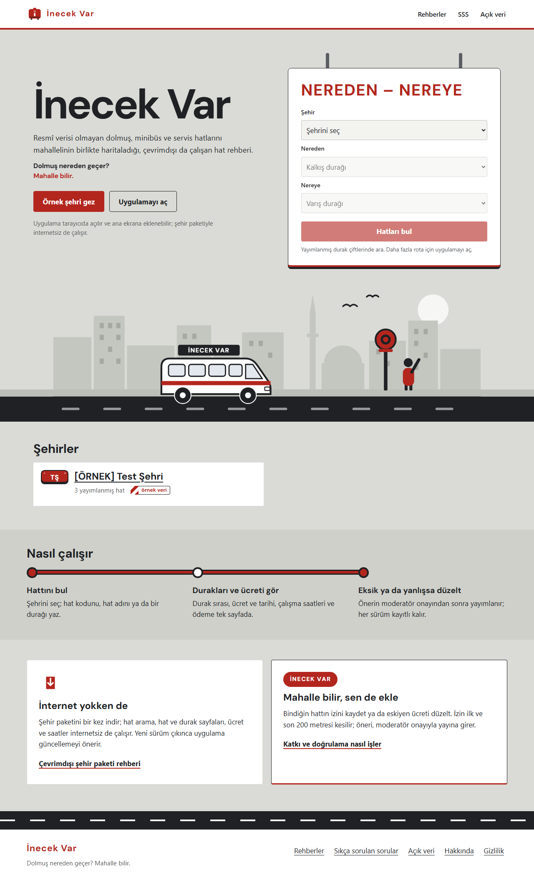
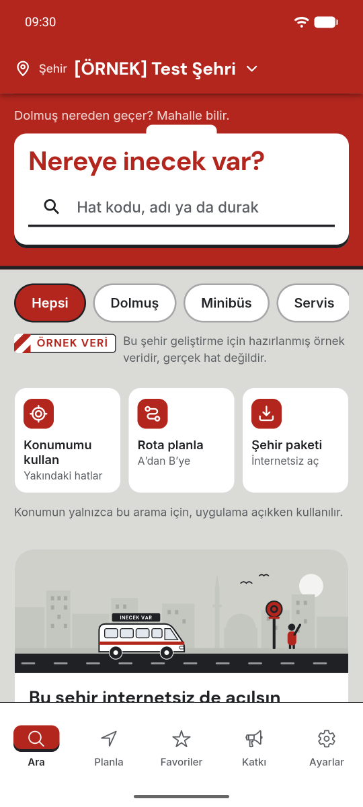
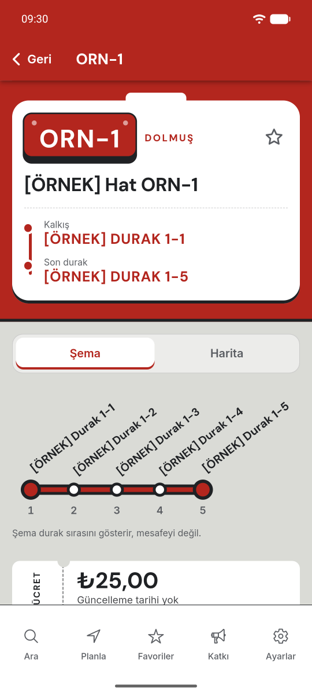
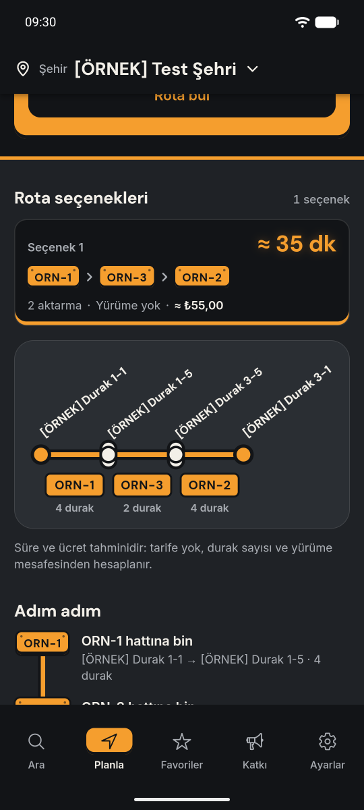

[English](README.md) | Türkçe

# İnecek Var

[](https://github.com/ayberkaarda/Mobiles-5in-One/actions/workflows/inecekvar-ci.yml)
[](https://github.com/ayberkaarda/Mobiles-5in-One/actions/workflows/inecekvar-security.yml)

"Dolmuş nereden geçer? Mahalle bilir."



  

Yerel derlemeden web ana sayfası ve `Pixel_8` emülatöründen Android ekranları, ikisi de yerel yığında örnek veriyle. [Hat sayfası](docs/screenshots/route-sign/web-line.png), bir [rehber](docs/screenshots/route-sign/web-guide.png) ve [koyu ana sayfa](docs/screenshots/route-sign/web-home-dark.png) `docs/screenshots/route-sign` içinde. Statik bir [web demo](https://ayberkaarda.github.io/Mobiles-5in-One/inecekvar/) GitHub Pages'te çalışır; giriş ve formlar orada çalışmaz.

## Ürün özeti

İnecek Var, resmî verinin çoğu zaman eksik olduğu Türkiye şehirlerinde dolmuş, minibüs ve servis
hatları için kitle kaynaklı bir güzergâh haritası. Yolcular hatlara, duraklara, ücretlere ve
saatlere bakar, aktarmalı A'dan B'ye yolculuk planlar, çevrimdışı şehir paketleri indirir; mahalle
katkıcıları yolculuklarını GPS iziyle kaydeder, hat önerir ya da düzenler, moderatörler inceleyip
yayınlar. Adı, yolcunun dolmuşu durdurmak için seslendiği sözden gelir. Dil sokaktan, esprili ve
net. Proje, FastAPI backend'li bir Nx workspace'idir (Ionic ve Angular uygulaması ile PWA, Angular
SSR web).

## Durum

Portföy projesi. Planlanan yedi fazın hepsi (0 ile 6) `main`'e birleşti (pull request #118 ile
#128 arası): temel kurulum; veri modeli, çift kimlik doğrulama ve güvenlik temeli; domain,
moderasyon, izler, planlayıcı, şehir paketleri, dışa aktarma ve hesap silme; Ionic uygulaması ve
PWA; TOTP step-up arkasında moderasyon ve yönetim arayüzüyle Angular SSR SEO ve GEO sayfaları;
yetkiler ve gece işleriyle RevenueCat ve Resend webhook'ları; sertleştirme ve yayına hazırlık.
Fazlardan sonra bir test flake düzeltmesi, galeri ve web ana sayfası, görsel yeniden tasarım
(ADR-0059) ve onun güzergâh tabelası düzenlemesi (#138) geldi.

| Alan                                               | Durum                                                                                                                                      |
| -------------------------------------------------- | ------------------------------------------------------------------------------------------------------------------------------------------ |
| API, web, uygulama ve PWA, moderasyon, yönetim     | Gerçek kod; web e2e ve mobil e2e paketleri gerçek yerel yığına karşı çalışır                                                             |
| Android                                            | Capacitor kabuğu; ekran görüntüleri için `Pixel_8` emülatöründe çalıştırıldı; Android CI işi elle tetiklenir                              |
| Plus aboneliği (RevenueCat), e-posta (Resend)      | Webhook'lar, mutabakat ve engelleme listesi fixture'larla test edildi; gerçek hesap yok, mağaza satın alımı yok                          |
| Haritalar                                          | PMTiles ile MapLibre; barındırılan bir harita altlığı yapılandırılmadığı için uygulama ve web önce durak şemasını gösterir (ADR-0059)     |
| Yedekler                                           | Şifreli yedekler ve `Inecek Var restore drill` iş akışı (GitHub Actions'taki son koşu 2026-10-20'de geçti); R2 bucket'ı yok              |
| Barındırma, alan adı, TLS ve HSTS preload, Sentry, iOS | Kurulmadı; üretim Caddyfile'ı denenmedi                                                                                                |
| Hukuki metinler                                    | Örnek metinler; açık maddeler [`docs/release/legal-open-items.md`](docs/release/legal-open-items.md) dosyasında                          |

Nihai doğrulama matrisinde ([`docs/security/verification-matrix.md`](docs/security/verification-matrix.md))
15 satır tamam, 8 satır kısmi, 0 satır başlanmamış; kısmi satırlar barındırma, alan adı ve TLS, R2,
sağlayıcı hesapları, iş akışlarının GitHub'da koşması, iOS ve sahip kararları gerektirir. Phase 6
kapısı ([ADR-0058](docs/adr/0058-phase-6-gate.md)) 0 atlanan testle 1195 geçen API testi kaydetti;
yeniden tasarımdan sonra ([ADR-0059](docs/adr/0059-visual-redesign.md)) gerçek yığında web e2e
paketi 65, mobil e2e paketi 11 geçen test gösterir.

## MVP özellikleri

- Hat kodu veya adıyla, serbest metinle ya da yer yazarak/haritaya dokunarak A→B arama; cihaz konumuyla yakındaki hatlar.
- Hat sayfası: haritada güzergâh, sıralı duraklar, güncelleme tarihli ücret, saatler, ödeme yöntemleri, nasıl durdurulur notları, son doğrulama tarihi ve "Bu hat değişti" bildirimi.
- A→B planlayıcı: en fazla 2 aktarmalı, 3 seçenekli rota ve tahmini ücret.
- Çevrimdışı şehir paketleri (hat ve durak verisi, harita altlığı); ücretsiz planda 1 şehir.
- Katkıcılar: e-posta/şifre veya magic link ile kayıt, yolculukta iz kaydı, durak işaretleme, ücret/saat/not ve isteğe bağlı fotoğrafla öneri gönderme, mevcut hatları düzenleme.
- Moderasyon: harita farkı gösteren inceleme kuyruğu, değiştirilemez hat sürümüne onaylama, gerekçeyle reddetme, herhangi bir sürüme geri alma; katkıcı kendi önerisini onaylayamaz.
- Favoriler: misafirde yerelde, giriş yapanda senkronize.
- Plus aboneliği (yalnızca native uygulamalar): sınırsız çevrimdışı şehir ve destekçi rozeti.
- Açık veri: şehir bazında haftalık, açık lisanslı herkese açık dışa aktarma.
- Uygulama içinden ve web'den hesap silme; katkılar lisans kapsamında anonimleştirilerek kalır.
- Web: şehir sayfaları, hat ve durak sayfaları, rehber yazıları, yasal sayfalar ve moderasyon/admin arayüzü.

Kapsam dışı: gerçek zamanlı araç takibi, bilet satışı, araç çağırma, resmî veri iddiası, reklam,
sürücü hesapları, push bildirimleri (v2'de düşünülüyor), şehirler arası rota.

## Teknoloji yığını

| Katman            | Teknoloji                                                                                 |
| ----------------- | ----------------------------------------------------------------------------------------- |
| Mobil ve PWA      | Ionic 9.0.7, Angular 22.2, Capacitor 8.5 (Android kabuğu)                                 |
| Web               | Express üzerinde Angular SSR 22.2                                                         |
| Haritalar         | PMTiles 4.5 ile MapLibre GL JS 6.11; herkese açık sayfalarda sunucuda çizilen SVG haritalar |
| Monorepo araçları | Nx 23.3, pnpm 12, Vitest, Playwright, ESLint, Prettier                                    |
| Backend API       | Python 3.12 üzerinde FastAPI 0.143, Pydantic 2.14                                         |
| Veritabanı        | PostGIS 3.5'li PostgreSQL 16, SQLAlchemy 2.1, Alembic 1.20                                |
| Önbellek ve işler | Redis 7.4, arq 0.25 worker'ları                                                           |
| Nesne depolama    | S3 uyumlu (yerelde MinIO, Cloudflare R2 planlandı)                                        |
| Abonelik          | RevenueCat (yalnızca native)                                                              |

Çözümlenen sürümler ve gerekçeleri [`docs/adr/0001-stack-and-versions.md`](docs/adr/0001-stack-and-versions.md) dosyasında.

## Mimari

`apps/mobile` (Ionic ve Angular, aynı zamanda PWA olarak sunulur), `apps/web` (Angular SSR) ve UI,
domain tipleri ile API istemcisi için ortak `libs/` içeren bir Nx workspace'i; yanında ayrı bir
Python `api/` projesi. Rota planlayıcı, yayın sırasında şehir başına bellekte bir graf kurar ve
sonuçları önbelleğe alır. Web ve PWA istemcileri çerez oturumu, native istemciler bearer token
kullanır; ikisi de tek bir kimlik doğrulama arayüzünün arkasındadır. Herkese açık hat, durak ve
şehir sayfaları sunucuda render edilir; güzergâh haritaları SVG olarak çizildiği için istemci
tarafında harita kodu gerekmez. Ham GPS izleri yalnızca sahibine ve moderatörlere açıktır ve
türetilen hat sürümü yayınlandıktan 30 gün sonra silinir.

## Kurulum

Gereksinimler: Node 22, pnpm 12, uv, Docker; Android derlemesi için JDK 21. `inecekvar/` içinden
(Compose yalnızca veri ve proxy servislerini çalıştırır: PostGIS, Redis, MinIO, Mailpit, Caddy):

```sh
pnpm install --frozen-lockfile
docker compose up -d
pnpm exec prettier --check .
pnpm nx run-many -t lint test build
pnpm nx serve web        # ya da: pnpm nx serve mobile
```

`inecekvar/api/` içinden:

```sh
uv sync --locked
uv run alembic upgrade head
uv run ruff check . && uv run ruff format --check . && uv run mypy --strict app tests alembic
uv run pytest
uv run uvicorn app.main:app --host 127.0.0.1 --port 57800 --no-proxy-headers --forwarded-allow-ips 127.0.0.1
```

Caddy `/api/*` isteklerini 57800 portuna iletir; portlar, ortam değişkenleri ve ilk kurulum
(`python -m app.ops.bootstrap`) [`docs/ops/env.md`](docs/ops/env.md) dosyasında. Katkı kuralları
[`CONTRIBUTING.md`](CONTRIBUTING.md) dosyasında.

## CI

- `Inecek Var CI`: workspace (marka token'ları, Prettier, `nx run-many -t lint test build`), API
  (ruff, mypy, pytest, OpenAPI sözleşmesi), kontroller (Compose doğrulaması, tüm geçmişte gitleaks)
  ve elle tetiklenen Android debug derlemesi.
- `Inecek Var Security`: tüm geçmişte gitleaks, `pnpm audit` ve `pip-audit` (yüksek ve kritik), iki
  kilit dosyası için OSV taraması, Bandit, Semgrep proje kuralları ve CycloneDX SBOM.
- `Inecek Var restore drill`: şifreli bir yedeğin MinIO ve age ile yeni bir PostGIS 16'ya geri
  yüklenmesi.

## Dokümantasyon

- Ürün ve teknik tanım: [`05-inecekvar-ionic-angular.md`](05-inecekvar-ionic-angular.md)
- Mimari kararlar: [`docs/adr/`](docs/adr/); faz kapıları ADR-0036, ADR-0042, ADR-0050 ve ADR-0058
- Raporlar: [nihai rapor](docs/handoffs/final-report.md) ve [faz raporları](docs/handoffs/)
- API: [`docs/api/openapi.json`](docs/api/openapi.json)
- Güvenlik: [doğrulama matrisi](docs/security/verification-matrix.md), [tehdit modeli](docs/security/threat-model.md), [yetkilendirme matrisi](docs/security/authorization-matrix.md), [saldırı raporu](docs/security/attack-report.md), [pentest raporu](docs/security/pentest-report.md), [XSS taraması](docs/security/xss-sweep.md), [tarama raporları](docs/security/scan-reports/), [bağımlılık denetimi](docs/security/dependency-audit.md), [geçmiş temizleme runbook'u](docs/security/history-purge-runbook.md)
- Operasyon: [ortam](docs/ops/env.md), [arka plan işleri](docs/ops/background-jobs.md), [yedekleme ve geri yükleme](docs/ops/backup-restore.md), [maliyet uyarıları](docs/ops/cost-alerts.md), [loglama](docs/ops/logging.md)
- Yayın: [yayın kontrol listesi](docs/release/release-checklist.md), [mağaza metni](docs/release/store-listing.tr.md), [gizlilik etiketleri](docs/release/privacy-labels.md), [imzalama](docs/release/signing.md), [PMTiles tarifi](docs/release/pmtiles-recipe.md)
- SEO ve GEO: [kontrol listesi](docs/seo/checklist.md), [ASO](docs/seo/aso.md)

## Lisans

Bu proje MIT Lisansı ile lisanslanmıştır. Bkz. [LICENSE](../LICENSE).
