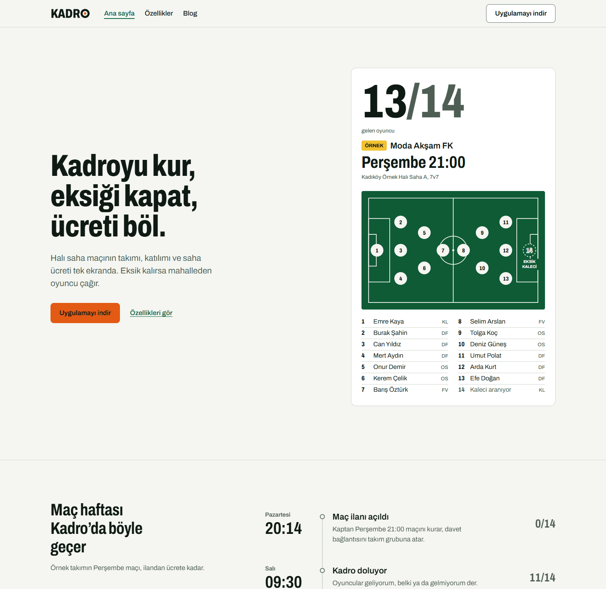
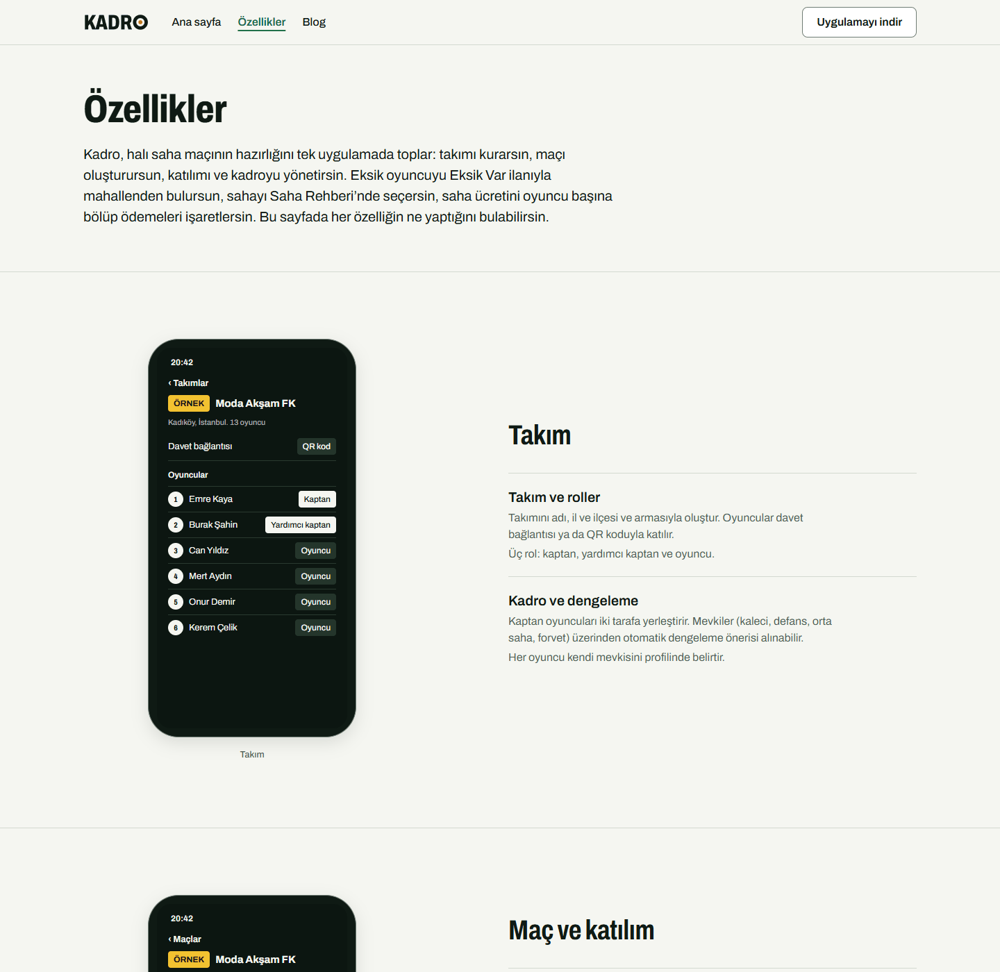
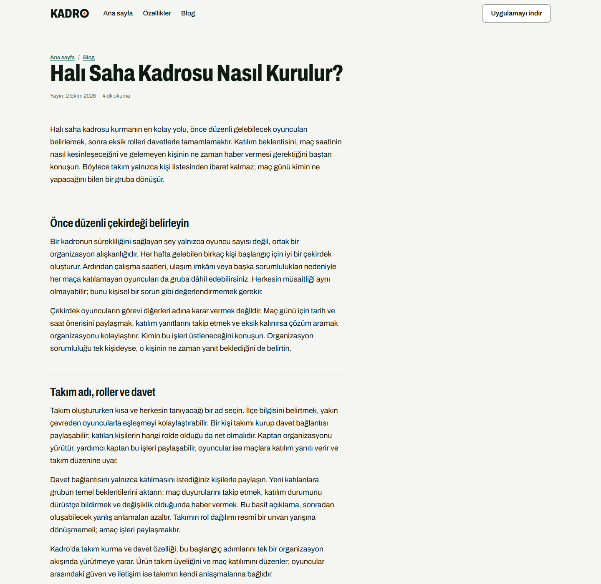
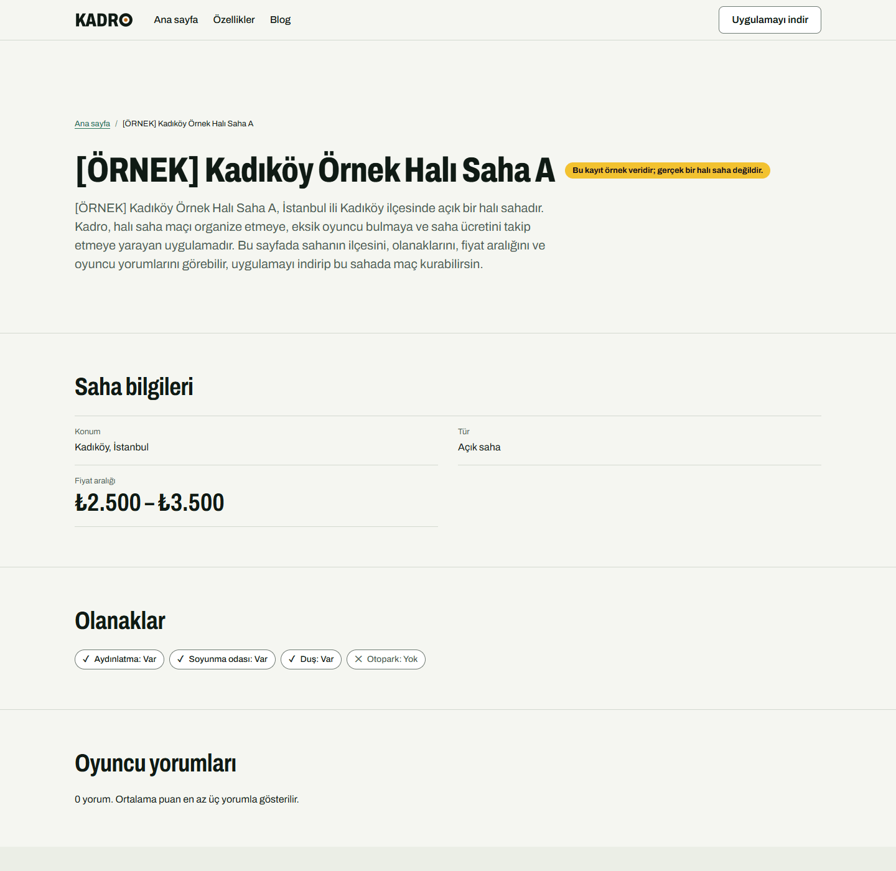
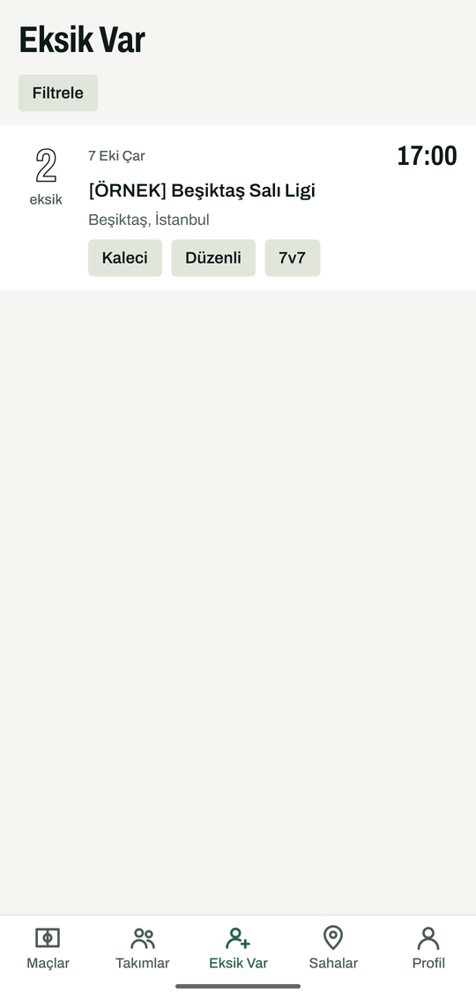
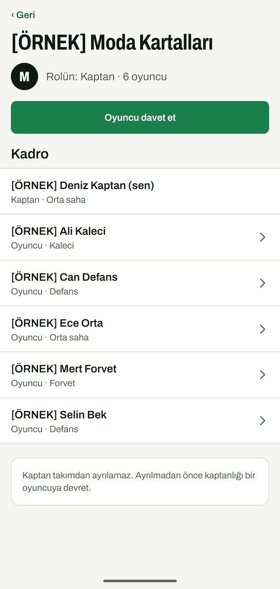
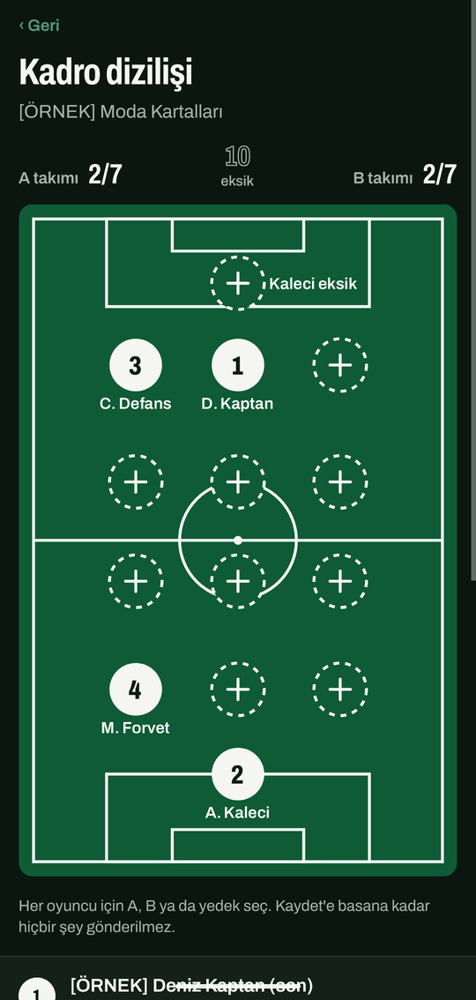
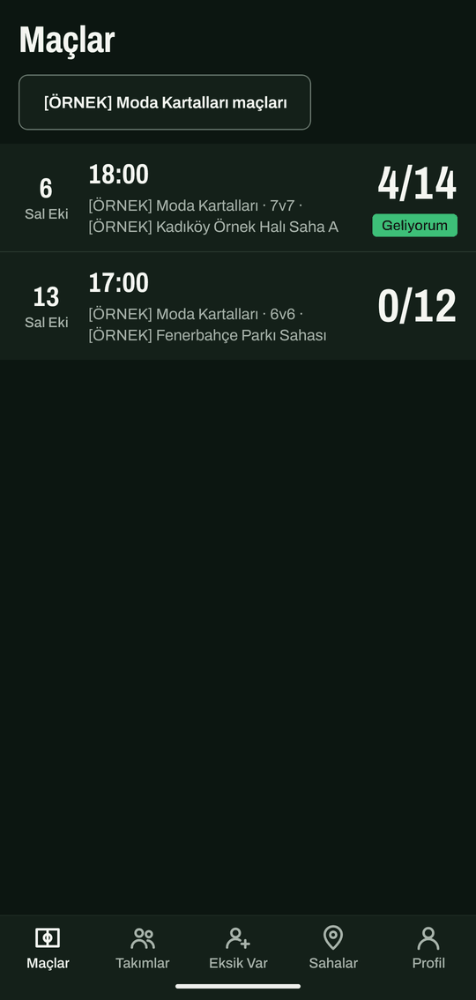
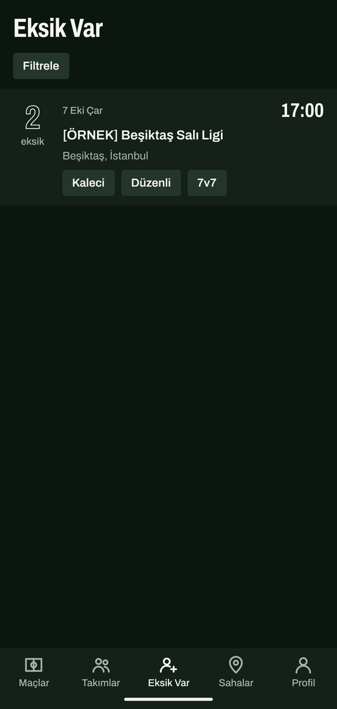
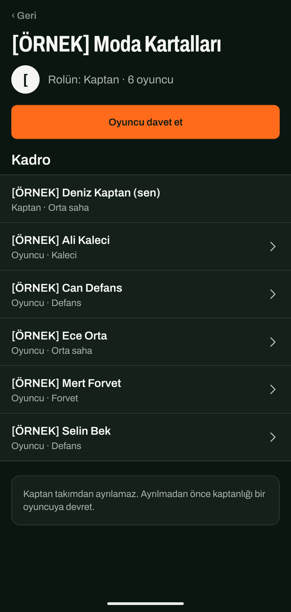

English | [Türkçe](README.tr.md)

# Kadro

[](https://github.com/ayberkaarda/Mobiles-5in-One/actions/workflows/kadro-ci.yml)
[](https://github.com/ayberkaarda/Mobiles-5in-One/actions/workflows/kadro-security.yml)

Match organizer for amateur pitch football (halı saha). Build your squad, find the missing player,
split the pitch fee. No money moves inside the app; the captain only tracks who has paid. One
TypeScript monorepo holds the Expo app, the Next.js web and REST API, the pg-boss worker and the
shared packages. A static [web demo](https://ayberkaarda.github.io/Mobiles-5in-One/kadro/) of the
public pages runs on GitHub Pages; sign-in and forms do not work there.

## Status

Portfolio project. All seven planned phases (0 to 6) are merged to `main`: data model and
security core, domain API and worker jobs, the mobile app, the marketing and SEO pages, the Kadro
Pro subscription with the staff admin panel, and the hardening and release work (attack suite,
MobSF scan, dependency audit, restore drill, cost guard, history-purge runbook, store copy, privacy
labels, SEO and GEO checklist). The dual-scheme redesign (light and dark, ADR-0084) came after.

What is real and what is not:

| Area                                                         | State                                                                                                                                                                                           |
| ------------------------------------------------------------ | ----------------------------------------------------------------------------------------------------------------------------------------------------------------------------------------------- |
| API, web pages, admin panel, worker, database, authorization | Real code, run locally in Docker and in the test suites; `Kadro CI` and `Kadro Security` run on every change to `kadro/`                                                                        |
| Mobile app                                                   | Real Expo app; the screenshots come from an Android emulator. The 11 Maestro flows in `apps/mobile/.maestro/flows/` have no recorded run (the manual `Kadro mobile e2e` workflow has never run) |
| Kadro Pro (RevenueCat)                                       | Webhook, reconciliation and entitlements tested with fixtures and a local fake server; no store account, nothing purchased                                                                      |
| Apple and Google sign-in, push, email                        | Code paths with tests; not run against the real providers                                                                                                                                       |
| Backups                                                      | `ops/restore-drill.sh` and the `Kadro restore drill` workflow restore a local PostGIS dump (last run on GitHub Actions passed on 2026-10-19); no production bucket                              |
| Hosting, domain, TLS, Sentry, provider cost alerts, iOS      | Not set up; there is no Caddy edge configuration or deploy runbook in the repository                                                                                                            |
| Legal texts                                                  | Sample texts, labelled as such, not reviewed                                                                                                                                                    |

The security verification matrix ([`docs/security/verification-matrix.md`](docs/security/verification-matrix.md))
lists 13 of 23 items as done and 10 as partial, each with the missing proof named. Lighthouse lab
LCP is 2.5 to 2.7 s on some pages, just above the 2.5 s target (ADR-0084).

`apps/mobile` is the Expo app (Turkish and English screens), `apps/worker` runs the pg-boss jobs
(reminders, push, email, uploads, venue import, deletion, billing, `cost.guard`), and `apps/web`
serves the REST API under `/api/v1`, the public web pages and the staff panel under `/admin`.

## Screenshots

The screenshots show sample data labelled `[ÖRNEK]`: the web pages come from a local stack and the mobile screens from an Android emulator. Real devices, real venues and a deployed site are not shown. The full sets, with the capture method, are in [`docs/screenshots/README.md`](docs/screenshots/README.md) (mobile) and [`docs/screenshots/web-README.md`](docs/screenshots/web-README.md) (web).

### Web (follows the system light or dark setting)

<table>
  <tr>
    <td align="center">
      <picture>
        <source media="(prefers-color-scheme: dark)" srcset="docs/screenshots/web/web-01-home-dark.png">
        
      </picture><br>
      <sub>Home page</sub>
    </td>
    <td align="center">
      <picture>
        <source media="(prefers-color-scheme: dark)" srcset="docs/screenshots/web/web-02-features-dark.png">
        
      </picture><br>
      <sub>Features page</sub>
    </td>
  </tr>
  <tr>
    <td align="center">
      <picture>
        <source media="(prefers-color-scheme: dark)" srcset="docs/screenshots/web/web-04-blog-article-dark.png">
        
      </picture><br>
      <sub>Blog article</sub>
    </td>
    <td align="center">
      <picture>
        <source media="(prefers-color-scheme: dark)" srcset="docs/screenshots/web/web-05-venue-dark.png">
        
      </picture><br>
      <sub>Venue page</sub>
    </td>
  </tr>
</table>

### Mobile (top row light, bottom row dark)

<table>
  <tr>
    <td align="center">
      <br>
      <sub>Lineup</sub>
    </td>
    <td align="center">
      <br>
      <sub>Matches</sub>
    </td>
    <td align="center">
      <br>
      <sub>Open calls</sub>
    </td>
    <td align="center">
      <br>
      <sub>Team</sub>
    </td>
  </tr>
  <tr>
    <td align="center">
      <br>
      <sub>Lineup</sub>
    </td>
    <td align="center">
      <br>
      <sub>Matches</sub>
    </td>
    <td align="center">
      <br>
      <sub>Open calls</sub>
    </td>
    <td align="center">
      <br>
      <sub>Team</sub>
    </td>
  </tr>
</table>

## MVP features

"Implemented" means the code, the API contract and automated tests exist on `main`. Mobile rows
carry the label "device flows not verified": the screens are covered by unit and component tests,
but no run of the Maestro flows (`apps/mobile/.maestro/`) on a device or emulator is recorded.

| Feature                                                                                                  | Status                                                                                                     |
| -------------------------------------------------------------------------------------------------------- | ---------------------------------------------------------------------------------------------------------- |
| Email + password registration and login, Apple and Google sign-in, password reset                        | Implemented (API and mobile screens; provider sign-in not run on devices)                                  |
| Database schema, migrations and seed data (districts, sample venues)                                     | Implemented                                                                                                |
| Teams, roles (captain, co-captain, player), invite links                                                 | Implemented (API, mobile; device flows not verified)                                                       |
| Matches, RSVP with waitlist, lineup with position balancing                                              | Implemented (API, mobile; device flows not verified)                                                       |
| Fee split and paid/unpaid tracking                                                                       | Implemented (API, mobile; device flows not verified)                                                       |
| Open calls ("Eksik Var"): publish a missing-player call, browse and apply                                | Implemented (API, mobile, public web listings; device flows not verified)                                  |
| Venue directory ("Saha Rehberi") with ratings, reviews and venue suggestions                             | Implemented (API, mobile; device flows not verified)                                                       |
| Reminders and notifications (push, email) through the worker                                             | Implemented (worker jobs; real push and email delivery not verified)                                       |
| MVP vote and basic player stats                                                                          | Implemented (API, mobile profile and match screens)                                                        |
| Kadro Pro subscription (RevenueCat), server-enforced entitlements, in-app paywall                        | Implemented, merged but not verified against real stores (webhook and entitlements tested with fixtures)   |
| Account deletion in the app and on the web (`/hesap-silme`)                                              | Implemented (7-day grace period, tombstone history); email delivery not verified                           |
| Marketing site, blog, sample-labelled legal pages (KVKK notice, privacy, contact)                        | Implemented (legal text is sample text, not legal advice)                                                  |
| Programmatic pages: venue pages and "Eksik Var" district pages, sitemap, JSON-LD                         | Implemented (Lighthouse is informational in CI; no real domain yet)                                        |
| Invite landing page (`/mac/<code>`) and app link files                                                   | Implemented (app link files not verified with signed store builds)                                         |
| Staff admin panel (`/admin`): venue verification, venue CSV import, roles, bans, audit log, TOTP step-up | Implemented (web only, Playwright-covered; review and open-call removal have API endpoints but no screens) |
| OpenAPI 3.1 description of every `/api/v1` operation                                                     | Implemented (`docs/api/openapi.json`, built from the endpoint registry)                                    |

Explicit non-goals for the MVP: in-app payments between players, venue booking integration, live
chat, video, ads, leagues and tournaments, languages other than Turkish and English.

## Technology stack

- Mobile: Expo 57 (React Native 0.86), Expo Router, TypeScript 6
- Web and API: Next.js 16 (App Router), REST under `/api/v1`
- Database: PostgreSQL 16 with PostGIS 3.5, Drizzle ORM 0.45 and SQL migrations
- Background jobs: pg-boss 12 (worker app)
- Validation and contracts: zod 4
- Passwords: Argon2id; access tokens: ES256 JWT; refresh tokens with rotation
- Tooling: Node.js 22, pnpm 12 workspaces, Turborepo, Vitest, Playwright, ESLint, Prettier

Exact pinned versions and the reasoning behind them are in
[`docs/adr/0001-stack-and-versions.md`](docs/adr/0001-stack-and-versions.md).

## Repository structure

```
apps/
  mobile/      Expo app
  web/         Next.js: API (/api/v1), public pages and the staff panel (/admin)
  worker/      pg-boss job runner
packages/
  auth/        authorization policy, password hashing, token utilities
  brand/       design tokens, logo SVGs, fonts
  config/      validated environment configuration (only reader of process.env)
  contracts/   zod schemas and shared types
  db/          Drizzle schema, migrations, seed data
docs/
  adr/         architecture decision records
  api/         OpenAPI document built from the endpoint registry
  handoffs/    cross-package hand-off notes
  legal/       legal review checklist
  mobile/      mobile app documents
  ops/         hosting, operations, runbooks
  release/     store listing, backup drill, cost alerts
  security/    authorization matrix, threat model, verification matrix
  seo/         SEO and GEO checklist
  web/         web app documents, including the admin panel
```

## Requirements

- Node.js: the version in [`.nvmrc`](.nvmrc) (the `engines` field requires at least 22.12.0)
- pnpm: the version pinned in the `packageManager` field of [`package.json`](package.json)
- Docker, for the local database and for the database-backed tests

## Setup and running

All commands run from this directory (`kadro/`).

```sh
pnpm install
cp .env.example .env
pnpm --silent --filter @kadro/config secrets:generate
```

`secrets:generate` prints the signing keys, CSRF secret and hash secret; paste them over the empty
keys in `.env`. The web app refuses to start while they are empty.

```sh
pnpm db:up                           # PostgreSQL + PostGIS in Docker
pnpm build                           # workspace packages must be built first
pnpm --filter @kadro/db db:migrate   # apply migrations
pnpm --filter @kadro/db db:seed      # districts and [ÖRNEK] sample venues
pnpm dev                             # web on http://localhost:3000 and the worker
```

Other commands:

| Command                                       | Purpose                                                                                                                                                         |
| --------------------------------------------- | --------------------------------------------------------------------------------------------------------------------------------------------------------------- |
| `pnpm worker:dev`                             | worker only                                                                                                                                                     |
| `pnpm mobile:start`                           | start the Expo dev server                                                                                                                                       |
| `pnpm lint` / `pnpm typecheck` / `pnpm build` | lint, type-check and build every package                                                                                                                        |
| `pnpm test`                                   | run all tests                                                                                                                                                   |
| `pnpm format` / `pnpm format:check`           | write or check Prettier formatting                                                                                                                              |
| `docker compose up --build`                   | full stack in containers (web + worker + database)                                                                                                              |
| `node ops/zap-scan.mjs`                       | OWASP ZAP site and API scans against a disposable local stack (after building web and worker; see [`docs/security/zap-report.md`](docs/security/zap-report.md)) |

## Environment variables

[`.env.example`](.env.example) lists every variable with comments. Values are local-development
dummies except the signing keys, CSRF secret and hash secret, which are intentionally empty and
created per machine with `pnpm --silent --filter @kadro/config secrets:generate`. Real values for
preview and production belong in the hosting provider's secret store, never in the repository.
Apps fail fast at boot when a required variable is missing or invalid.

## Tests

`pnpm test` runs the Vitest suites of every package. The database tests (`@kadro/db`) and the web
API tests (`@kadro/web`) start a disposable PostGIS container, so a running Docker daemon is
required; without one they fail with an explicit message. The admin panel has a Playwright suite
(`pnpm --filter @kadro/web test:e2e`).

CI workflows in [`../.github/workflows`](../.github/workflows/): `Kadro CI` runs lint, typecheck,
build and the tests, with Lighthouse as an informational job; `Kadro Security` scans the full
history with gitleaks, audits dependencies (high and critical) and runs the secret and placeholder
greps; `Kadro restore drill` dumps a seeded PostGIS and restores it into a fresh container;
`Kadro mobile e2e` (Maestro on an Android emulator) is manual and has not been run.

## Security approach

Authorization is enforced server-side from a documented matrix; secrets are never committed;
refresh tokens, invite codes and email tokens are stored only as hashes; authentication endpoints
are rate-limited; responses carry strict headers and per-surface CSP. CI scans the full history for
secrets and audits dependencies. Details:

- [`docs/security/authorization-matrix.md`](docs/security/authorization-matrix.md)
- [`docs/security/threat-model.md`](docs/security/threat-model.md)
- [`docs/security/verification-matrix.md`](docs/security/verification-matrix.md)
- [`docs/security/history-purge-runbook.md`](docs/security/history-purge-runbook.md)
- [`docs/security/attack-report.md`](docs/security/attack-report.md) and [`docs/security/zap-report.md`](docs/security/zap-report.md) (attack suite, OWASP ZAP site and API scans with a real database, run manually)
- [`docs/adr/`](docs/adr/) (security-relevant decisions such as ADR 0011, 0014, 0015, 0019, 0021)

## Documentation

- [`docs/adr/README.md`](docs/adr/README.md): index of architecture decision records
- [`docs/security/`](docs/security/): security documents
- [`docs/ops/README.md`](docs/ops/README.md): hosting and operations
- [`docs/ops/admin-recovery.md`](docs/ops/admin-recovery.md): staff lockout and TOTP loss runbook
- [`docs/api/README.md`](docs/api/README.md): API conventions and the OpenAPI document built from the endpoint registry
- [`docs/web/admin-panel.md`](docs/web/admin-panel.md): staff admin panel
- [`docs/mobile/`](docs/mobile/): mobile architecture, screens, billing, deep links
- [`docs/release/`](docs/release/): store listing, backup drill, cost alerts
- [`docs/seo/`](docs/seo/): SEO and GEO checklist
- [`docs/handoffs/`](docs/handoffs/): hand-off notes between packages
- [`docs/screenshots/README.md`](docs/screenshots/README.md): screenshot sets and how they were taken

## Roadmap

- Phase 0, foundation: done
- Phase 1, data, auth and security core: done
- Phase 2, domain API and worker jobs (teams, matches, open calls, venues, uploads, reminders): done, merged
- Phase 3, mobile app: done, merged (device flows not verified)
- Phase 4, web SEO pages, marketing site and public listings: done, merged
- Phase 5, Kadro Pro subscription, webhook and admin area: done, merged (store purchases not
  verified against real stores)
- Phase 6, hardening and release readiness: done, merged (verification matrix, threat model,
  attack report, MobSF report, dependency audit, restore drill, cost guard, history-purge runbook,
  ASO, store listing and privacy labels, SEO and GEO checklist, placeholder grep in CI)
- After the phases: the dual-scheme redesign of the app and the web (ADR-0084)

Open proofs, all needing systems that do not exist here: Maestro runs on a device or emulator,
store and RevenueCat verification, EAS builds and a signed update channel, a hosted origin with
the Caddy edge and a deploy runbook, production backups, Sentry, provider-side cost alerts, a ZAP
scan of a hosted preview (the local database-backed and API scans ran), a sitemap submission on a
real domain, iOS.

## License

This project is licensed under the MIT License. See [LICENSE](../LICENSE).
