[English](README.md) | Türkçe

# Patika

[](https://github.com/ayberkaarda/Mobiles-5in-One/actions/workflows/patika-ci.yml)

"Mahallenin patilerini birlikte koruyalım."

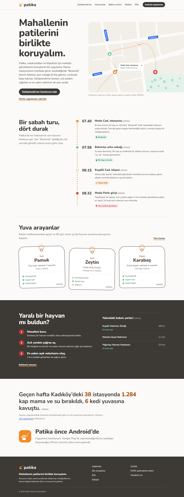

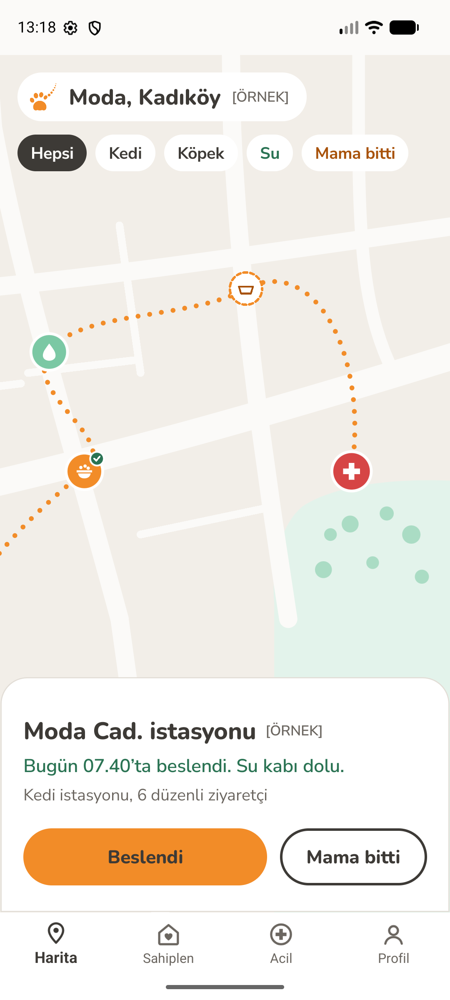 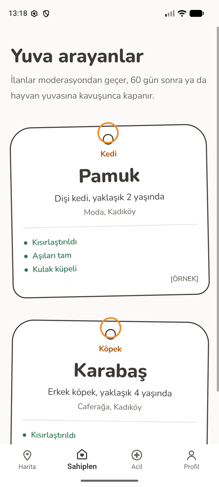 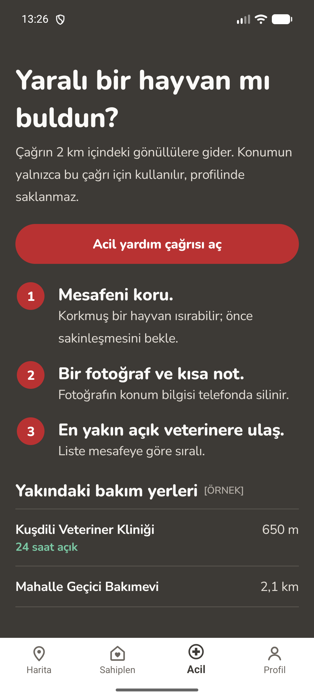 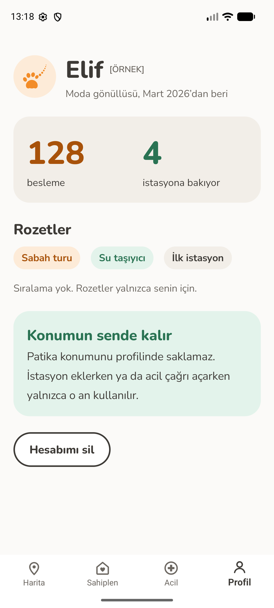

Web ana sayfası yerel derlemeden, Android ekranları `Pixel_8` emülatöründen; ikisi de yerel yığına karşı, `[ÖRNEK]` verilerle. Diğer ekranlar [galeride](#galeri).

Canlı demo: [herkese açık webin statik görüntüsü](https://ayberkaarda.github.io/Mobiles-5in-One/patika/) GitHub Pages'te. Yerel derlemeden, `[ÖRNEK]` verilerle alındı; canlı bir hizmet değil: giriş, yönetim paneli, ilçe filtresi ve uygulama orada çalışmaz.

## Ürün özeti

Patika, mahalle gönüllülerini buluşturan bir sokak hayvanları topluluk platformu. Mama istasyonu haritası, "Beslendi" check-in'leri, hayvan profilleri, sahiplendirme ilanları, acil yardım gönderileri ve yakındaki veteriner ile bakımevi rehberi sunar. Ad "patika" yolundan geliyor ve içinde "pati" geçiyor. Dil sıcak ve "biz" diliyle yazılır, saygılıdır, suçluluk duygusu yaratmaz. Gönüllü gizliliği ürünün bir özelliğidir: fotoğrafların konum bilgisi yüklemeden önce ve sunucuda yeniden silinir, gönüllü konumları hiç saklanmaz. Kod tek bir .NET 10 çözümüdür: ASP.NET Core API, yönetim
paneliyle Razor Pages web, bir Worker ve .NET MAUI Android uygulaması.

## Durum

Portföy projesi. Planlanan yedi fazın hepsi (0 ile 6) `main`'e birleşti (pull request #134, #135,
#139 ve #141 ile #147 arası): temel kurulum; API çekirdeği, kimlik doğrulama ve güvenlik temeli;
domain API, medya ve bildirim; mobil için API ve Android uygulaması; yönetim paneliyle SEO ve GEO
web; simüle Play aboneliği; sertleştirme ve yayına hazırlık. 7. faz yok. Neyin gerçek, neyin simüle
olduğu [Gerçek / simüle](#gerçek--simüle) bölümünde.

[`docs/handoffs/phase-6-report.md`](docs/handoffs/phase-6-report.md) içindeki son koşu
`dotnet test Patika.slnx` için 1.456 geçen ve 0 başarısız test kaydeder (Api 511, App 223, Domain
51, Security 480 ve taşınmış bir PostGIS'e karşı geçen 2 atlanmış test, Web 123, Worker 68).
Güvenlik doğrulama matrisi 23 maddenin 19'unu tamam, 4'ünü kısmi gösterir ([Güvenlik](#güvenlik)).

## Özellikler

- E-posta ve şifreyle giriş (6 haneli e-posta kodları), Google ile giriş (kod yolu hazır; çalışması için OAuth istemcisi gerekir), harita ve ilanlarda hesapsız gezinme.
- Kümelenen ve filtrelenen mama istasyonu haritası (kedi veya köpek, mama veya su, "mama bitti"); son check-in'ler ve "Beslendi" düğmesiyle istasyon ayrıntısı; son bölgenin çevrimdışı önbelleği ve check-in'ler için giden kutusu.
- Sağlık bilgileri, takip ve görülme kayıtlarıyla hayvan profilleri; moderasyonlu sahiplendirme ilanları, başvurular ve yanıtlar; 60 gün sonra veya sahiplenilince kapanır.
- Acil Yardım: 2 km içindeki gönüllülere bölgesel bildirim; gönderi (500 cihaz), yazar ve gün başına sınırlı.
- CSV ile içe aktarılan veteriner ve bakımevi rehberi.
- Besleme sayısı ve rozetlerle gönüllü profili; sıralama tablosu yok.
- Patika Destekçi aboneliği (simüle Google Play Billing): destekçi rozeti ve daha yüksek fotoğraf kotası.
- Uygulamada ve web'de hesap silme: 7 günlük bekleme süresi ve ardından tam temizlik.
- Web sitesi: herkese açık sahiplendirme, istasyon, ilçe ve bakım yeri sayfaları, beş rehber, yasal metin taslakları, gerçek sayılarla etki sayfası, `llms.txt`, site haritaları ve JSON-LD; şifre ve TOTP ile girilen, yıkıcı işlemlerde yeniden doğrulama isteyen ve her işlemi denetim kaydına yazan yönetim paneli.

Kapsam dışı: bağış, sohbet, veteriner randevusu, canlı takip, sıralama tablosu, reklam, iOS.

## Galeri

| | |
| --- | --- |
| 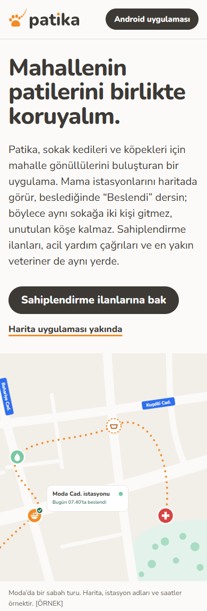 | 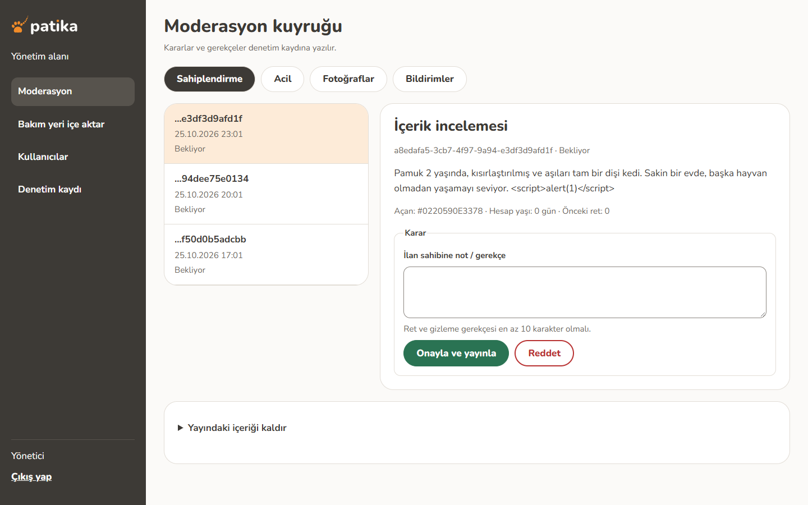 |
| 390 px web girişi | Moderasyon kuyruğu: kaydedilmiş `<script>` metin olarak görünür |
| 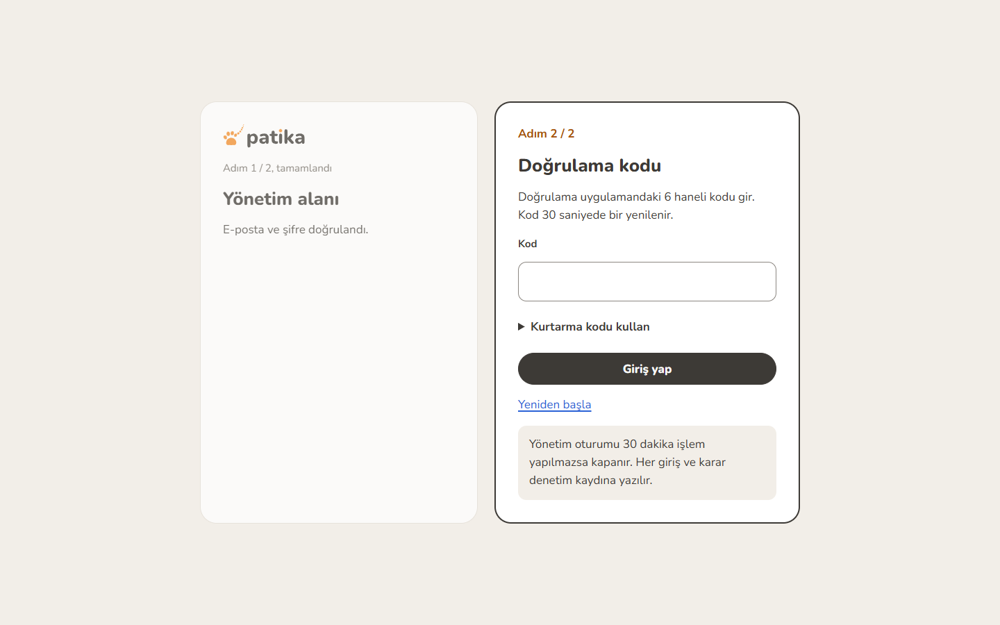 | 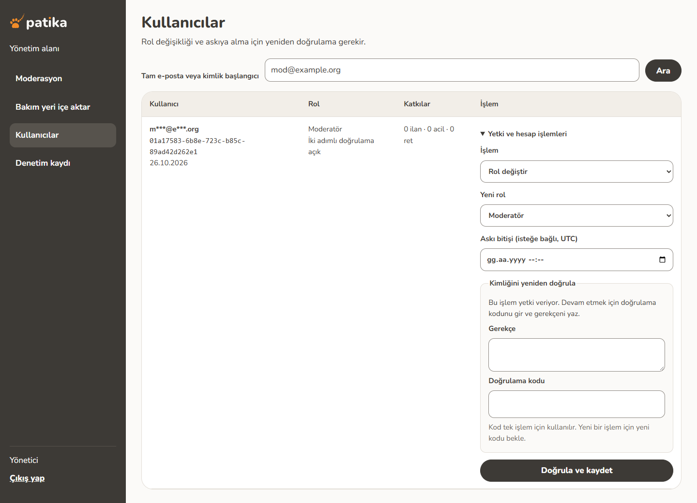 |
| Yönetim girişi, ikinci adım | Yeniden doğrulamalı kullanıcılar sayfası |
| 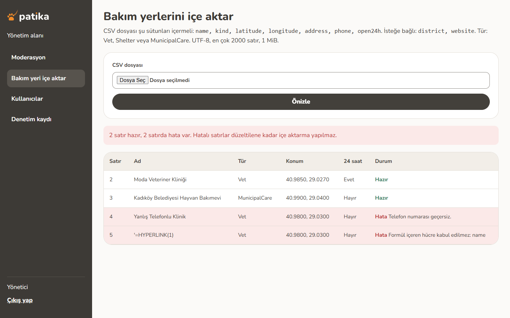 | 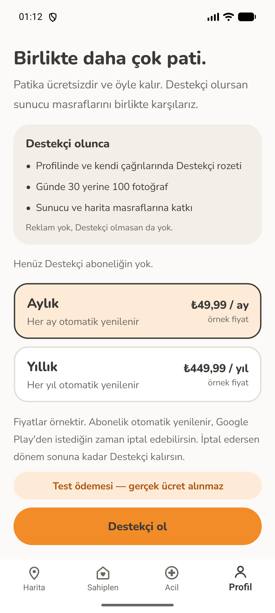 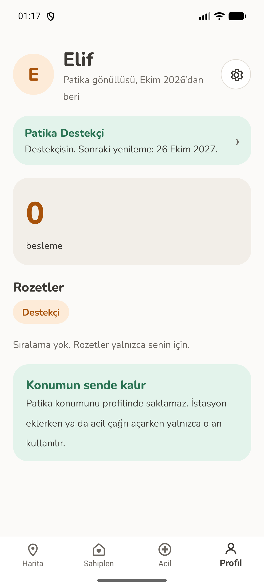 |
| Reddedilen satırlarla CSV içe aktarma | Destekçi ödeme ekranı ve simüle satın alım sonrası profil |

Play Store görselleri (1080x1920 altı ekran ve öne çıkan görsel) [`docs/release/play-assets`](docs/release/play-assets/) içinde.

## Teknoloji

| Katman | Teknoloji |
| --- | --- |
| Mobil uygulama | .NET 10 MAUI (C#), yalnızca Android (`net10.0-android`) |
| Arka uç API | ASP.NET Core minimal API (C#), Npgsql ve NetTopologySuite ile EF Core |
| Web ve yönetim | ASP.NET Core Razor Pages, sunucuda üretilir, istemci JavaScript'i yok; yönetim paneli API'nin önünde bir BFF |
| Arka plan işleri | .NET Worker (bildirim dağıtımı, silme, mutabakat, maliyet koruması, yedek kontrolü) |
| Veritabanı | PostgreSQL 17 ve PostGIS 3.5 |
| Nesne deposu | S3 uyumlu (yerelde MinIO, planda Cloudflare R2); görseller SkiaSharp ile yeniden kodlanır |
| Bildirim, e-posta, ödeme | FCM HTTP v1, Resend, Google Play Billing: yerel taklitlerle çalışan kod yolları (aşağıda) |

## Mimari

```
app/Patika.App            MAUI Android uygulaması
src/Patika.Domain         varlıklar, izin matrisi, kurallar (altyapı bağımlılığı yok)
src/Patika.Contracts      API, Web ve uygulamanın paylaştığı DTO'lar
src/Patika.Infrastructure EF Core modeli ve migration'lar, depolama, log maskeleri, ödeme taşıyıcısı
src/Patika.Api            /v1 dikey dilimler, kimlik doğrulama (Argon2id, ES256 JWT, refresh aileleri, TOTP), hız sınırları
src/Patika.Web            salt okunur veritabanı rolüyle herkese açık SEO sayfaları, API'yi çağıran yönetim paneli
src/Patika.Worker         zamanlanmış ve kuyruklu işler
tests/                    Api, Security (saldırı paketi), Web, Worker, App ve Domain testleri
ops/                      yedek, geri yükleme ve tatbikat betikleri, CI yardımcıları (paket denetimi, ZAP)
```

Uygulama yalnızca API ile konuşur. Web herkese açık verileri salt okunur rolle okur, her yönetim işlemini API üzerinden yapar ve API token'larını yola kapsamlı bir çerezde şifreli tutar. Abonelik hakları sunucuda, doğrulanmış mağaza verisinden belirlenir. Kararlar [`docs/adr`](docs/adr/) içindeki ADR 0001 ile 0010 arasında.

## Gerçek / simüle

Patika bir portfolyo projesi: barındırılan bir servis, mağaza hesabı ya da şirket yok.

| Alan | Durum |
| --- | --- |
| API, Web, yönetim, Worker, veritabanı, migration'lar, yetki, kota, denetim | Gerçek kod; yerelde Docker'da ve testlerde çalışır |
| Android uygulaması | Gerçek uygulama, `Pixel_8` emülatöründe çalıştırıldı; yayımlanmadı |
| Google Play Billing | Simüle: uygulama `FakeBillingClient`, sunucu sahte Play Developer API kullanır; fiyatlar örnektir, ücret alınmaz ([ADR-0010](docs/adr/0010-play-billing-simulated.md), [demo](docs/demo/destekci.md)) |
| Play RTDN webhook | Gerçek doğrulama kodu (Pub/Sub OIDC JWT), yalnızca yerel RSA test anahtarlarıyla sınandı |
| Bildirim (FCM), e-posta (Resend), Google ile giriş | Kod yolları var; kimlik bilgisi olmadan loglayan veya "yapılandırılmadı" diyen göndericilere düşer |
| Barındırma, alan adı, TLS, R2, buluta yedek | Kurulmadı; yedek ve geri yükleme tatbikatı yerel Docker'da çalışır |
| Yasal metinler | "Taslak" işaretli, hukuki inceleme yok |
| Örnek içerik | `[ÖRNEK]` satırlar, yalnızca `Web:ShowSamples` açıkken görünür |

## Yerelde çalıştırma

Gerekenler: .NET SDK 10.0.400 ya da sonraki bir 10.0.4xx yaması (`global.json`), Docker; uygulama için MAUI Android iş yükü, JDK 21 ve bir Android emülatörü.

```sh
cp .env.example .env              # varsayılan Development; yerelde gizli bilgi gerekmez
docker compose up --build -d      # PostGIS, MinIO, API :5000, Web :5001, Worker
```

API, migration'ları yalnızca compose'da açılışta uygular. Sunucudaki 5432 portu boş olmalı (ya da port değiştirilmeli). Kayıt kodları API'nin geliştirme posta klasörüne yazılır. Uygulamayı emülatörde çalıştırmak için:

```sh
dotnet build app/Patika.App/Patika.App.csproj -f net10.0-android -t:Run
```

Testler Docker ister (Testcontainers):

```sh
dotnet test Patika.slnx
dotnet format Patika.slnx --verify-no-changes
dotnet build app/Patika.App/Patika.App.csproj -f net10.0-android -c Release
bash ops/ci/zap/zap-baseline.sh   # geçici bir compose yığınına ZAP baseline taraması
```

Ayar anahtarları [`docs/ops/env.md`](docs/ops/env.md) içinde.

## Güvenlik

23 maddenin hepsi [doğrulama matrisinde](docs/security/verification-matrix.md) kanıtıyla eşlendi: 19 tamam, 4 kısmi (HTTPS, Play webhook'u, yedekler ve saldırgan gibi test maddesi; her birinde kanıtın bir kısmı gerçek bir alan adı, Play hesabı veya bulut deposu istiyor). Ayrıca: [pentest raporu](docs/security/pentest-report.md), [tehdit modeli](docs/security/threat-model.md), [yetki matrisi](docs/security/authorization-matrix.md), [sertleştirme notları](docs/security/hardening.md), [ZAP](docs/security/scans/zap.md) ve [MobSF](docs/security/scans/mobsf.md) sonuçları, [geçmiş temizleme kılavuzu](docs/security/history-purge-runbook.md). Operasyon: [yedek ve geri yükleme](docs/ops/backup-restore.md), [maliyet uyarıları](docs/ops/cost-alerts.md), [loglama](docs/ops/logging.md). Yayın belgeleri: [Play listesi](docs/release/play-listing.md), [Veri Güvenliği](docs/release/data-safety.md), [imzalama](docs/release/signing.md).

## CI

- `Patika CI`: backend (restore, derleme, bitmemiş kod işareti grep'i, `dotnet test`,
  `dotnet format`), Android (zafiyetli paket kontrolü, CycloneDX envanteri, Release derlemesi,
  birleşmiş yayın manifest kontrolü), Compose doğrulaması, Web ve yönetim girişine ZAP baseline ve
  tüm geçmişte gitleaks taraması. `patika/` değiştiğinde bir kapı işi tüm işlerin geçmesini ister.
- `Patika restore drill` (PostGIS 17, MinIO, age): haftalık zamanlanmış; GitHub Actions'ta kayıtlı
  bir koşusu henüz yok. Aynı tatbikat yerelde `ops/backup/drill.sh` ile çalışır.

## Dokümantasyon

- Ürün tanımı: [`03-patika-swift-ios.md`](03-patika-swift-ios.md) (ilk olarak Swift ve iOS için yazıldı; içindeki not .NET MAUI ve Android'e geçişi kaydeder, bkz. [ADR-0001](docs/adr/0001-stack-and-versions.md))
- Mimari kararlar: [`docs/adr/`](docs/adr/) (ADR-0001 ile ADR-0010)
- Faz raporları: [`docs/handoffs/`](docs/handoffs/), sonuncusu [`phase-6-report.md`](docs/handoffs/phase-6-report.md)
- Herkese açık web veri kuralları: [`docs/public-web-data.md`](docs/public-web-data.md)
- Tasarım ve ekran görüntüleri: [`docs/design/`](docs/design/); simüle ödeme demosu: [`docs/demo/destekci.md`](docs/demo/destekci.md)
- Katkı kuralları: [`CONTRIBUTING.md`](CONTRIBUTING.md)

## Lisans

Apache License 2.0. Bkz. [LICENSE](../LICENSE).
